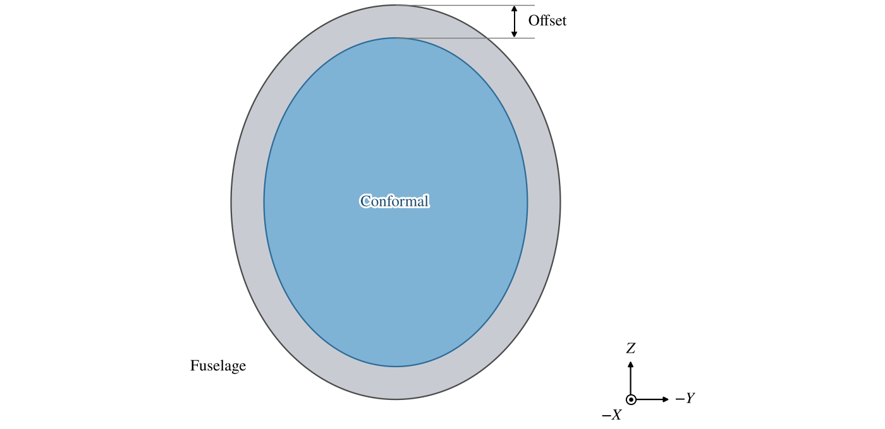
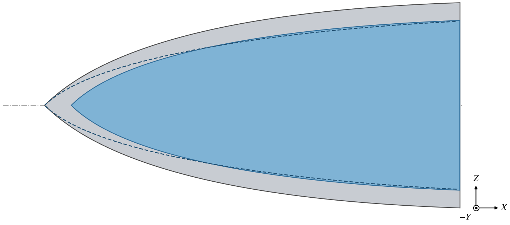
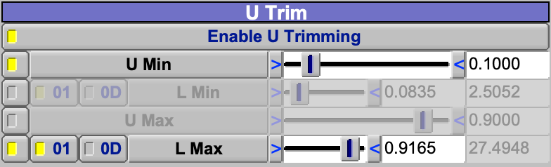
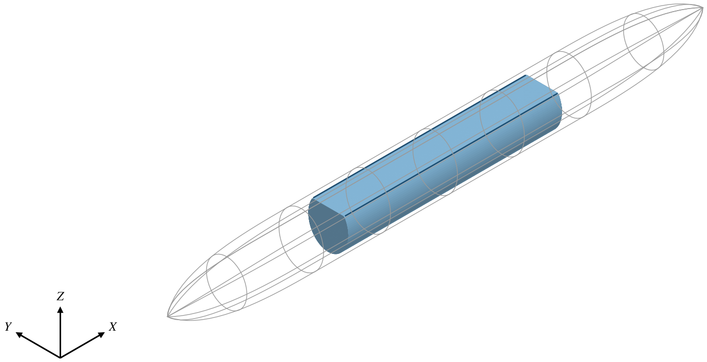
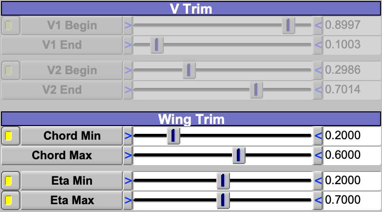
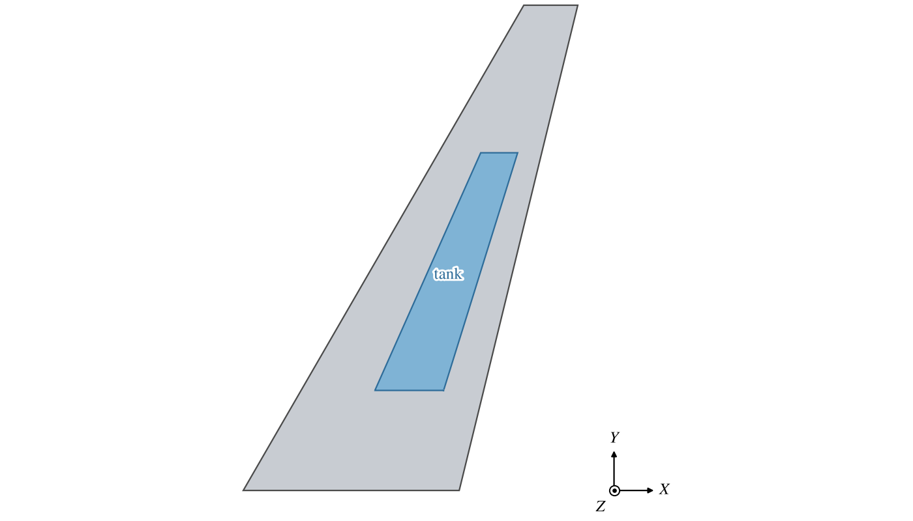
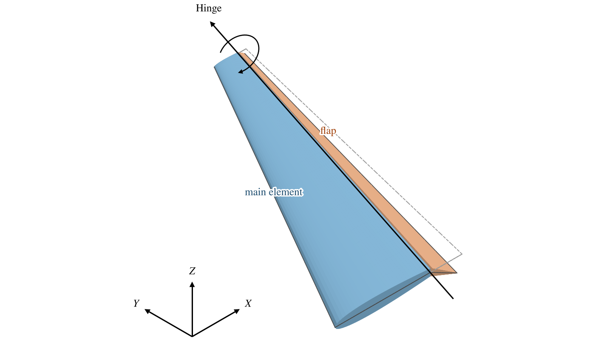

Conformal 是跟随另一个组件表面的曲面，与该表面保持指定的向内或向外距离。它由该组件（*conformal parent*，共形父件）生成，并随父件修改而变化。可沿父件长度及周向裁剪，因此可表示机翼油箱、机身客舱或货舱、蒙皮内的结构包络，或表面的涂层和隔热层。

| 主题 | 标签页 |
|:-----|:-------|
| [快速开始](#quick-start) | |
| [共形父件](#the-conformal-parent) | Design |
| [偏移](#offset) | Design |
| [纵向裁剪](#trimming-along-the-length) | Design |
| [周向裁剪](#trimming-around-the-surface) | Design |
| [机翼裁剪](#trimming-a-wing) | Design |
| [铰接襟翼](#a-hinged-flap) | Design |
| [脚本](#scripting) | |

[Gen](GenTab.md)、[XForm](XFormTab.md)、[Mass](MassTab.md) 和 [Sub](SubTab.md) 标签页另有说明。

## 快速开始

### 机身内油箱

1. 选择 Fuselage，再添加 Conformal。它成为机身子级，并位于机身表面。
2. 将 *Offset* 设为蒙皮与油箱之间的结构厚度。
3. 勾选 *Enable U Trimming*，用纵向 *L Min*、*L Max* 设置油箱起止位置。
4. 如需避开地板或龙骨，用 Side Trim 将对应侧面裁平。

### 机翼内油箱

1. 选择 Wing，再添加 Conformal。
2. 将 *Offset* 设为蒙皮厚度。
3. 勾选 *Enable U Trimming*，选择 *Eta Min*、*Eta Max* 设置展向两端。
4. 勾选 Wing Trim 中 *Chord Min* 旁的开关，设置弦向两端。

## 共形父件

新共形组件从模型树中的父级获取形状，并挂接到父级，因此随之移动和镜像。XForm 的挂接与对称设置固定为跟随父级，控件呈灰色。

*Detach* 解除挂接绑定。旁边的 *Parent* 可选择共形父件，即除 Gear 外具有曲面的组件；列表虽也显示其他 Conformal，选择它们并不起作用。解除后，共形组件根据模型树中父级及自己的 XForm 设置放置，而模型树父级可以与共形父件不同。这样即可让舱门、整流罩或[襟翼](#a-hinged-flap)等蒙皮部分挂在铰链上，独立于提供形状的机体运动。

模型树中的父级为 Hinge 时，*Position on Hinge relative to Conformal Parent* 按共形父件所在位置确定组件相对铰链的位置，使铰链静止时组件贴合机体，偏转时随铰链运动。解除挂接后，对称仍跟随共形父件，对称控件仍呈灰色。

共形组件可基于 Fuselage、Stack、Wing、Pod、Ellipsoid、Body of Revolution、Cobra、Custom，或这些组件的 Clone 创建；基于克隆体时采用其位置。不能基于 Human、Gear 或另一个 Conformal 创建，否则 OpenVSP 报错。对于 Propeller 等没有偏移概念的组件，共形组件只是父件曲面的副本。基于 Cobra 时可以偏移，但所有裁剪均被忽略。

## 偏移

*Offset* 为距父件表面的距离，向内为正（图 1），负值使共形组件位于父件外侧。父件截面处保持指定偏移，截面之间仅近似满足。例如默认 Fuselage 设置偏移 0.1，实际距蒙皮约为 0.092 至 0.104。

*图 1：默认机身内 Offset 0.25 的共形组件，在长度中点同时截开两者。*

父件两端为尖点或端盖时，*Offset Ends* 也将共形组件两端向内移动。每端沿机体移动至与父件表面保持指定偏移，使组件在父件内部闭合（图 2）。取消时，两端仍位于父件头尾点并在那里与父件接触。对于机翼，两端沿展向内移相应偏移距离。

该复选框作用于截面构造组件：Fuselage、Stack、Wing 或 Custom。Pod、Ellipsoid、Body of Revolution 和 Cobra 的两端始终按偏移内移，复选框呈灰色。

*图 2：同一机身及共形组件的头部轴向剖面，填充部分启用了 Offset Ends，虚线未启用。*

除非进行了纵向裁剪，共形组件的端盖沿用父件端盖。

## 纵向裁剪

*Enable U Trimming* 裁掉共形组件两端。每端可用滑块前的切换按钮选择三种定位方式（图 3）：

- *U Min*、*U Max*：父件曲面参数 $U$ 的比例；相邻截面之间的 $U$ 增量相同，与实际间距无关。
- *L Min*、*L Max*：沿机体长度的位置。*01* 表示长度比例，*0D* 表示距起点的实际距离。
- *Eta Min*、*Eta Max*：机翼展向比例，见[机翼裁剪](#trimming-a-wing)。

*图 3：默认机身内共形组件的 U Trim，已启用 U 裁剪。起点使用 U Min，终点使用长度比例 L Max。未选形式呈灰色并显示同一端点的等价值，每个 L 旁还显示距起点的距离。*

每种设置都会换算并显示其他形式。已知机体站位时宜用 *L*。默认机身中，*U* 0.1 距头部为 2.5，而 *L* 0.1 约为 3，即全长的十分之一。两端不能交叉，彼此至少保留 0.001 的间隔。

裁剪端面使用 *U Trim Tip Treatment* 指定的端盖闭合，默认为 Flat。其工作方式与机身端盖相同，见[端盖](FuselageStack.md#end-caps)。

## 周向裁剪

周向裁剪在每个截面切掉一段，并以直线封闭切口。组件因此保持封闭，同时沿长度方向形成平面（图 4），可表示客舱平地板，或油箱两根翼梁之间的壁面。$W$ 是按父件曲面定义的截面周向比例。

*V Trim* 按 $W$ 指定切除区间。*V1* 沿 $W$ 增大方向切掉 *V1 Begin* 至 *V1 End*；若 Begin 大于 End，则区间跨过 $W = 0$。*V2* 同样切除第二段。默认两段分别以 $W = 0$、$W = 0.5$ 为中心，宽度均为 0.2。

非机翼组件优先使用 *Side Trim*。每侧只需一个值，切除区间始终以该侧为中心，因此加宽平地板时仍保持水平，且可裁四侧；V Trim 需指定每段两端，只能裁两段。只有区间不以某侧为中心时才使用 V Trim。

父件不是 Wing 时提供 *Side Trim*。*Side 1* 至 *Side 4* 的区间中心依次位于 $W$ = 0、0.5、0.25、0.75；每个值是切除区间占整周的比例。Fuselage、Stack、Ellipsoid 对应右侧（$+Y$）、左侧、底部、顶部；Pod 的 $W$ 从顶部起算，因此依次为顶部、底部、右侧、左侧。Body of Revolution 的 $W$ 绕截面变化，不是绕旋转轴；其 *U* 才绕轴变化。

*图 4：默认机身（轮廓）内 Offset 0.15 的共形组件，纵向保留 L 0.3 至 0.7，Side 4 0.3 将顶部裁平。*

## 机翼裁剪

基于 Wing 时，共形截面由机翼翼型向内偏移得到，两端沿展向内移相应偏移距离。Side Trim 区域改为 Wing Trim。

- 勾选 *Chord Min*、*Chord Max* 对应开关后，保留各翼型两个弦向比例之间的部分，裁去前后缘，形成类似油箱翼梁壁面的平壁。这会设置 *V1*、*V2*，使它们呈灰色（图 5）。比例从共形根部翼型的后缘计量，裁剪沿展向跟随各翼型的对应点：默认 Wing 设置 Chord Min 0.2、Chord Max 0.6 时，根部实际保留距前缘 0.41 至 0.79 弦长，翼尖保留 0.38 至 0.71（图 6）。
- *Eta Min*、*Eta Max* 按机翼展向比例裁剪，翼根为 0、翼尖为 1。用其前面的切换按钮代替 *U* 或 *L* 定位。

*图 5：默认机翼内 Offset 0.1 的共形组件，Chord Min 0.2、Chord Max 0.6，Eta 0.2 至 0.7，即图 6 的油箱。弦向裁剪已设定 V1、V2，因此两者呈灰色。*

*图 6：默认机翼内共形组件的俯视图，Offset 0.1，Eta 0.2 至 0.7，Chord Min 0.2，Chord Max 0.6。*

## 铰接襟翼

可用两个共形组件将 Wing 分为主翼面和可偏转襟翼，并将襟翼解除挂接后挂在铰链上，见[共形父件](#the-conformal-parent)和图 7。

给机翼添加两个 *Offset* 为 0 的共形组件，使用[机翼裁剪](#trimming-a-wing)：主翼面保留铰线前方，襟翼保留后方，使主翼面的 Chord Min 等于襟翼的 Chord Max。向机翼添加 [Hinge](Hinge.md)，放在襟翼前缘且轴线沿前缘。将襟翼移到铰链下（*Cut* 襟翼，选择铰链，再 *Paste*），勾选 *Detach*，Wing 仍作为共形父件。

铰链静止时襟翼保持在机翼上的原位，随后跟随铰链 *Rotate*。绕指向翼尖的轴正向旋转，会使襟翼后缘下偏。将原 Wing 从显示及分析集合中排除，由两个共形组件代表机翼。

*图 7：默认机翼由两个共形组件在弦向裁剪值 0.25 处拼接。襟翼挂在沿其前缘的铰链上，Rotate 30；虚线轮廓表示未偏转位置。*

## 脚本

| 控件 | 参数 | 默认值 |
|:-----|:-----|:-------|
| Detach | `DetachFlag` | 关闭 |
| Position on Hinge | `HingeConformalPositionFlag` | 开启 |
| Offset | `Offset` | 0.1 |
| Offset Ends | `OffSetEnds` | 开启 |
| Enable U Trimming | `UTrimFlag` | 关闭 |
| 两端裁剪类型 | `UMinTrimTypeFalg`、`UMaxTrimTypeFalg` | `U_TRIM`；另可选 `L_TRIM`、`ETA_TRIM` |
| U Min, U Max | `UTrimMin`、`UTrimMax` | 0.1、0.9 |
| L Min, L Max | `LTrimMin`、`LTrimMax`；`L0LenTrimMin`、`L0LenTrimMax` | 0.1、0.9 |
| 01 / 0D | `L01Min`、`L01Max` | 01 |
| Eta Min, Eta Max | `EtaTrimMin`、`EtaTrimMax` | 0.1、0.9 |
| V1, V2 | `V1TrimFlag`、`V1TrimBegin`、`V1TrimEnd`、`V2TrimFlag`、`V2TrimBegin`、`V2TrimEnd` | 关闭；0.9、0.1；0.4、0.6 |
| 弦向裁剪 | `ChordTrimFlag`、`ChordTrimMin`、`ChordTrimMax` | 关闭；0.1、0.9 |
| 侧面裁剪 | `Side1TrimFlag` … `Side4TrimFlag`、`Side1Trim` … `Side4Trim` | 关闭；0.1 |

以上参数位于 *Design* 组，注意原参数拼写确为 `UMinTrimTypeFalg`、`UMaxTrimTypeFalg`。

裁剪端盖参数位于 *EndCap* 组，包括 `CapUMinTrimOption`、`CapUMinTrimLength`、`CapUMinTrimOffset`、`CapUMinTrimStrength`、`CapUMinTrimSweepFlag` 及对应的 `CapUMax...` 参数。

使用 `AddGeom( "CONFORMAL", parent_id )` 添加共形组件；使用 `SetGeomParent` 移到铰链下时，仍保留其共形父件。
