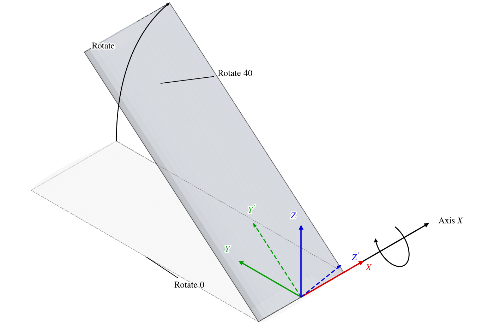
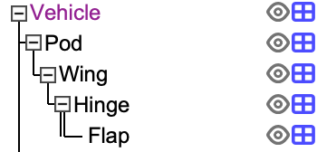
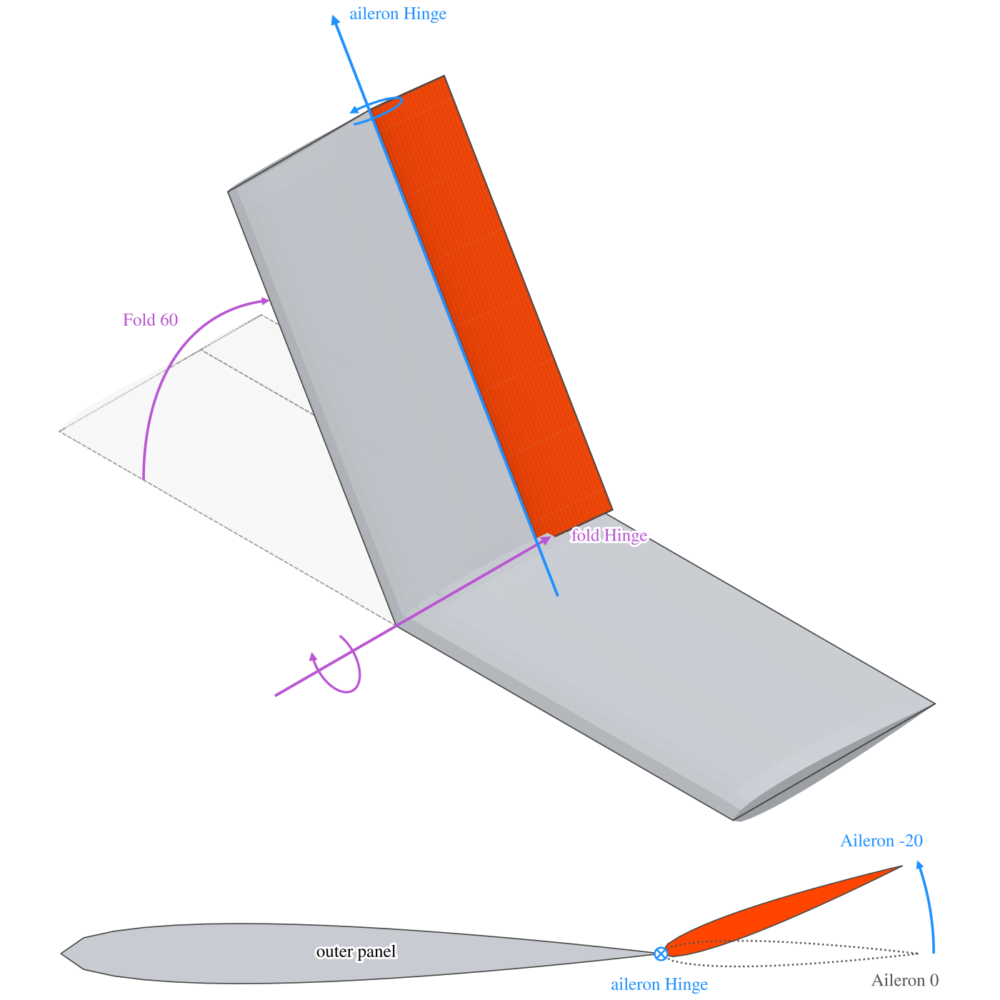
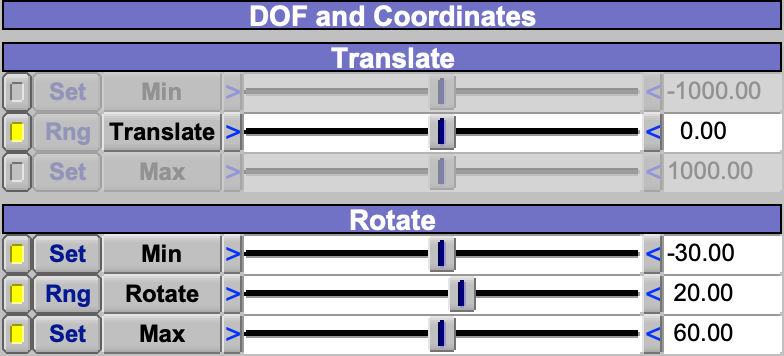
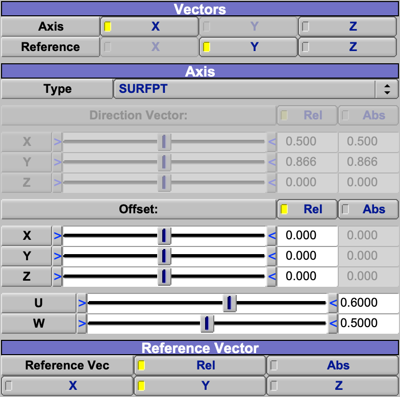
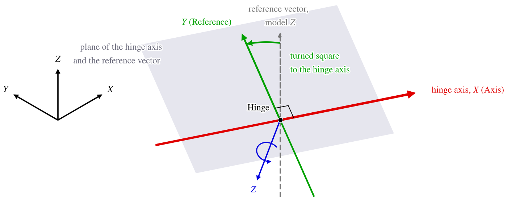

Hinge 组件表示关节，没有自身形状。它是一个可绕自身某条轴旋转、沿该轴平移的坐标系，并带动所有挂接组件。操纵面、舱门、折叠翼尖、倾转短舱和座舱盖等，都可将活动部件挂接到铰链，再设置铰链偏转来建模。

| 主题 | 标签页 |
|:-----|:-------|
| [快速开始](#quick-start) | |
| [如何带动子组件](#how-a-hinge-moves-its-children) | Motion |
| [运动与限位](#motion-and-limits) | Motion |
| [确定铰链方向](#orienting-the-hinge) | Orient、XForm |
| [翻转](#flip) | XForm |
| [其他用途](#other-uses-of-a-hinge) | |
| [不宜使用铰链的情况](#when-not-to-use-hinge) | |
| [通用标签页](#shared-tabs) | Gen、XForm |
| [脚本](#scripting) | |

## 快速开始

### 折叠翼尖

1. 添加 Hinge，在 XForm 标签页将其放在折叠线上；若应随机翼移动，将它挂接到机翼。
2. 用 XForm 旋转或 Orient 标签页，使自身 $X$ 轴沿折叠线，见[确定铰链方向](#orienting-the-hinge)。
3. 选中 Hinge 后添加外翼段，使外翼段成为铰链的子级。
4. 在 Motion 标签页设置 *Rotate*。

### 滑动座舱盖

1. 添加 Hinge，用 XForm 将其放在座舱盖处并挂接到机身。
2. 调整方向，使自身 $X$ 轴沿座舱盖滑动方向。
3. 选中 Hinge 后添加座舱盖，使座舱盖成为其子级。
4. 在 Motion 标签页允许 *Translate*、禁止 *Rotate*，再设置 *Translate*。

## 如何带动子组件

铰链有两个坐标系，都在三维视图中以其原点为基准绘制：实线表示 XForm 设置的自身坐标系，虚线表示施加关节位移后的关节坐标系。后者沿铰链轴平移 *Translate*，并按右手规则绕该轴旋转 *Rotate*：绕 $X$ 的正转角将 $+Y$ 转向 $+Z$（图 1）。默认铰链轴为自身 $X$，也可在 Orient 中改为 $Y$ 或 $Z$。

*图 1：翼段挂接在以自身 $X$ 为轴的铰链上，虚线轮廓为 Rotate 0，另一位置为 Rotate 40。实线坐标轴是铰链自身坐标系，带动翼段的关节坐标系用虚线表示。*

所有子组件都刚性挂接到关节坐标系。子组件的 [Attach To Parent](XFormTab.md#attach-to-parent) 选项呈灰色，其 XForm 相对位置和旋转均以关节坐标系计量，因此铰链偏转时，子组件保持在活动部件上的相对位置。子组件的下级仍按通常规则跟随，整套组件可由同一铰链带动，也可将铰链挂在另一铰链下形成关节链。几何体浏览器中，铰链与子级之间用双线表示关节带动关系（图 2）。

*图 2：机翼上的铰链带动襟翼，铰链与子级之间为双线。*

关节链中，每个铰链的偏转都相对于承载它的部件，因此组合运动与实际机构一致。例如折叠翼尖上的副翼由沿外翼段后缘挂接的铰链带动；折叠铰链带动外翼段，也连同带动副翼铰链。折叠翼尖时，副翼及其铰线一同移动，副翼随后绕折叠后的铰线偏转。每个实际关节对应一个 Hinge，并作为安装它的部件的子级，即可使各部件在各种偏转组合下保持连接（图 3）。

*图 3：沿 $X$ 的折叠铰链带动外翼段，沿外翼段后缘的副翼铰链带动副翼。虚线为 Fold 0、Aileron 0；实线为 Fold 60、Aileron -20，后者使副翼后缘抬起。下方放大图沿折叠后的副翼铰线向外看，点线表示副翼为 0 时的截面。*

铰链轴经过铰链原点，子组件应放在绕该轴运动的位置。若子组件建模时将自身铰线置于原点，则将其相对位置设为零，使两者原点重合。

## 运动与限位

滑块旁的复选框决定是否允许对应运动，禁止的运动固定为零（图 4）。默认允许 Rotate，禁止 Translate。勾选 *Min* 或 *Max* 后，相应数值成为不能越过的限位。可先将部件摆到止挡位置，再点击该限位的 *Set*，把当前位移或转角写入。*Rng* 根据已启用限位收缩或扩展滑块范围，便于在限位之间控制。

*图 4：已允许 Translate，Rotate 限位为 $-30^\circ$ 至 $60^\circ$，当前为 $20^\circ$。Translate 限位未勾选，因此限位滑块、Set 按钮及对应 Rng 均呈灰色。*

Translate 是沿铰链轴的长度，使用模型单位；Rotate 使用度，范围为 $-360$ 至 $360$。

三维视图以绕轴圆箭头表示允许 Rotate，以轴上箭头表示允许 Translate。

## 确定铰链方向

Orient 标签页决定铰链自身坐标轴的设置方式：

- *Rotations (Use XForm Tab)* 为默认值，与其他组件一样采用 XForm 旋转。
- *Vectors* 根据方向矢量构造坐标轴，XForm 转角由这些方向计算并呈灰色。

两种模式都由 *Axis* 选择自身 $X$、$Y$ 或 $Z$ 作为铰链轴，关节绕它旋转、沿它平移。Vectors 模式下（图 5），*Type* 决定该轴方向：

| Type | 铰链轴方向 |
|:-----|:-----------|
| VECTOR3D | 沿 *Direction Vector*（方向矢量）。 |
| POINT3D | 从铰链原点指向 *Offset* 给出的点。 |
| SURFPT | 从铰链原点指向父级曲面 *U*、*W* 处再加 *Offset* 偏移后的点。 |
| UDIR | 沿父级曲面 *U*、*W* 处的 $u$ 方向。 |
| WDIR | 沿父级曲面 *U*、*W* 处的 $w$ 方向。 |
| NDIR | 沿父级曲面 *U*、*W* 处的法向。 |

*Rel* 以铰链所挂接坐标系表达矢量或偏移；挂接父级时即为相应父级坐标系。SURFPT 的偏移是例外，始终使用父级坐标轴。*Abs* 使用模型坐标轴。曲面类型要求父级具有曲面。在机翼操纵面所在站位使用 UDIR，可令铰链轴跟随该处展向。

*图 5：机翼上的铰链采用 Vectors、SURFPT，U 0.6、W 0.5。Offset 和 U、W 可编辑，Direction Vector 呈灰色并显示计算出的铰链轴方向。Axis 与 Reference 不能相同，因此 Axis 下的 Y 和 Reference 下的 X 呈灰色。*

仅确定一条轴还不能确定零转角姿态。*Reference Vector*（参考矢量）沿模型或挂接坐标系的 $X$、$Y$、$Z$，用于确定绕铰链轴的基准转向：被选为 *Reference* 的铰链自身轴，放在铰链轴与参考矢量构成的平面内，并垂直于铰链轴（图 6）。

所有 Type 都使用参考矢量。与方向矢量相同，参考矢量的 *Rel* 与 *Abs* 分别选择挂接坐标轴和模型坐标轴，默认 *Rel*。

*图 6：左翼后掠铰线上的铰链采用 Vectors，VECTOR3D 沿铰线，Axis 为 $X$，Reference 为 $Y$，参考矢量沿模型 $Z$。参考矢量绕铰链 $Z$ 转至与铰链轴垂直，成为铰链 $Y$。模型坐标轴绘于模型原点，铰链处的坐标轴仅表示方向。*

## 翻转

XForm 的 [Flip](XFormTab.md#flip) 使铰链运动相对于所选平面呈现镜像效果，但不反射铰链坐标系本身或子组件。包含铰链轴的平面会反转 Rotate 的方向，垂直于铰链轴的平面会反转 Translate 的方向。要镜像铰接部件，必须同时翻转部件及其铰链。

铰链没有自身对称功能，对称控件呈灰色。一对镜像操纵面应使用两个铰链，或一个铰链及其[克隆体](Clone.md)。

## 其他用途

- 铰链的[克隆体](Clone.md)也是关节，自己的子级随它运动，可跟随原件偏转或独立设置。
- [扫掠体积](GeometryAnalysis.md#swept-volume)分析可将允许 Translate 的铰链作为次级几何体，沿铰链轴扫掠全部挂接组件。分析范围可为 Min 至 Max、Min 至当前 Translate、当前 Translate 至 Max，或向模型前方／后方延伸至模型以外。无论限位复选框是否启用，分析都会使用 Min 和 Max 数值。

## 不宜使用铰链的情况

- [起落架](Gear.md)轮架具有自身收放机构，应在该组件内描述收放，而不是另用 Hinge。
- [螺旋桨](Propeller.md)具有自身铰接与折叠机构。旋转以及内部的变距、挥舞、摆振和折叠运动，应使用螺旋桨自身功能。

## 通用标签页

Gen、XForm 为组件通用标签页，详见[通用设置](GenTab.md)与[变换](XFormTab.md)。铰链没有质量或曲面，因此没有 Mass 和 Sub 标签页。

## 脚本

脚本使用 `AddGeom( "HINGE" )` 添加铰链。参数位于 `Hinge` 组：

| 参数 | 含义 |
|:-----|:-----|
| `JointRotate`、`JointTranslate` | 关节偏转：分别使用度和沿轴的模型长度单位。 |
| `JointRotateFlag`、`JointTranslateFlag` | 是否允许相应运动。 |
| `JointRotMin`、`JointRotMax`、`JointTransMin`、`JointTransMax` | 各限位数值。 |
| `JointRotMinFlag`、`JointRotMaxFlag`、`JointTransMinFlag`、`JointTransMaxFlag` | 是否启用相应限位。 |
| `OrientRotFlag` | `HINGE_ORIENT_ROT`（Rotations）或 `HINGE_ORIENT_VEC`（Vectors）。 |
| `PrimaryDir`、`SecondaryDir` | *Axis* 与 *Reference*：`X_DIR`、`Y_DIR` 或 `Z_DIR`。 |
| `PrimType` | `HINGE_PRIM_VECTOR3D`、`_POINT3D`、`_SURFPT`、`_UDIR`、`_WDIR`、`_NDIR`。 |
| `PrimXVec`、`PrimYVec`、`PrimZVec` 和 `...Rel` | 方向矢量的 Abs 与 Rel 分量。 |
| `PrimXOff`、`PrimYOff`、`PrimZOff` 和 `...Rel` | 偏移的 Abs 与 Rel 分量。 |
| `PrimVecAbsRelFlag`、`PrimOffAbsRelFlag`、`SecVecAbsRelFlag` | `ABS` 或 `REL`。 |
| `PrimULoc`、`PrimWLoc` | 父级曲面的 *U*、*W*。 |
| `SecondaryVecDir` | 参考矢量：`X_DIR`、`Y_DIR` 或 `Z_DIR`。 |
