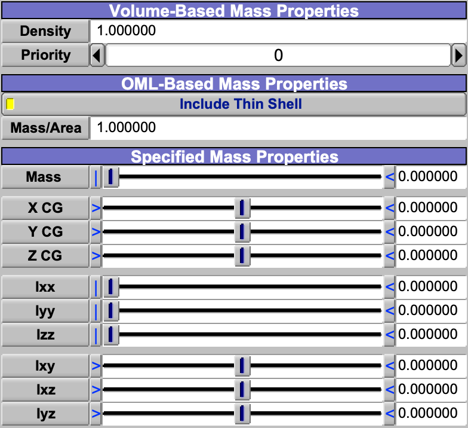
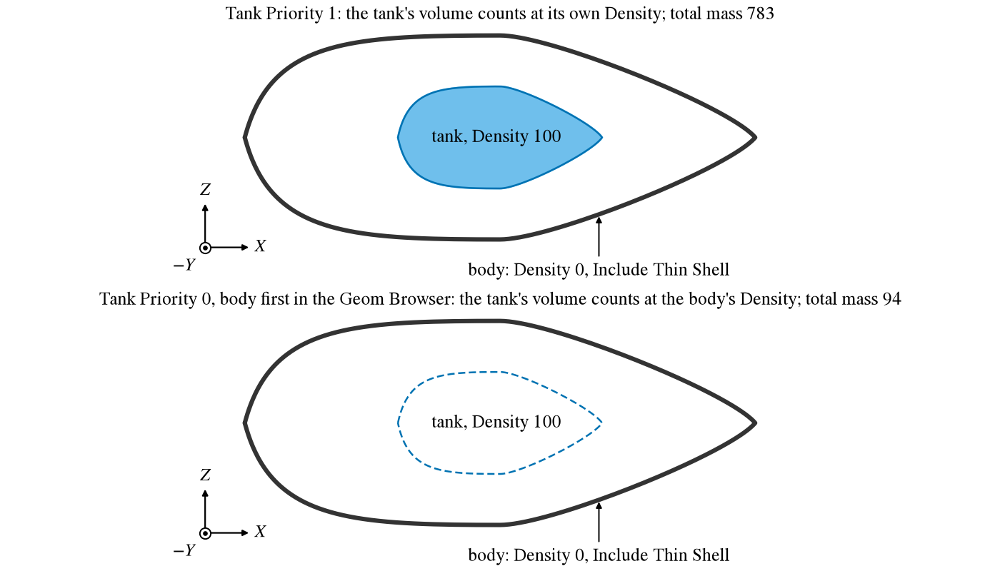

OpenVSP 中各组件（Geom）编辑窗口的通用标签页为 [Gen](GenTab.md)、[XForm](XFormTab.md)、Mass 和
[Sub](SubTab.md)。铰链、点云和线框没有 Mass 标签页。

Mass 标签页为[质量属性](GeometryAnalysis.md#mass-properties)分析提供数据。分析将各组件的贡献相加，
求得模型质量、重心和惯性。它采用类似 CAD 称量零件的自下而上估算：每个数值均来自模型形状和本页
设置，而非统计重量公式，因此结果的准确程度取决于所填密度和质量。

每个组件可以提供三部分质量，对应本页三个区域（图 1）：体积质量、湿面积上的薄壳质量和指定质量。
三者相加，可以使用任意一种、全部使用或全部不用。三者都须与模型单位一致：若密度采用质量除以
长度的三次方，计算结果就采用该质量单位。

*图 1：吊舱 Mass 标签页的 Volume-Based（基于体积）、OML-Based（基于外形面）和 Specified（指定）
三个区域，图中已启用 Include Thin Shell。*

| 主题 |
|:-----|
| [体积质量](#volume) |
| [薄壳质量](#thin-shell) |
| [指定质量](#specified-mass) |
| [管线、人体与克隆体](#routes-humans-and-clones) |
| [脚本](#scripting) |

## 体积质量

*Density*（密度）$\rho$ 与组件体积 $V$ 相乘得到质量 $m = \rho\,V$。
适用于内部实心的零件，如泡沫模型或铸件，也适用于空间内的内容物，如油箱内的燃油或货舱内的货物。
不需要体积质量的组件，将 *Density* 设为 0。

组件重叠时，共有体积只计算一次，采用 *Priority*（优先级）最高的组件的密度。
优先级相同时，几何体浏览器中靠前的组件优先。优先组件无论密度多少都占据该体积，密度为 0
也不会将体积让给其他组件。例如，机身仅有蒙皮质量（Density 为 0，并启用薄壳），若它与油箱
优先级相同且在浏览器中位于油箱之前，共有体积就按机身密度 0 计算，燃油质量为零（图 2）。
因此内容物的优先级应高于容纳它的组件。

*图 2：仅蒙皮有质量的机体与内部油箱的剖面。油箱优先级较高时（上），体积按油箱密度计算；
优先级相同时，浏览器中靠前的机体以自身密度 0 占据共有体积（下）。*

## 薄壳质量

*Include Thin Shell* 增加质量 $m = \rho_A\,S_{wet}$，即 *Mass/Area*（面密度）$\rho_A$
乘以组件湿面积。只计入暴露在其他组件外的面积，因此埋入机身的翼根不贡献薄壳质量，
完全位于其他组件内部的组件（如机身内的油箱）也没有薄壳质量，应改用指定质量表示其壁面质量。
薄壳适合主要由蒙皮构成的结构，如模压壳体；既可单独使用（Density 为 0），也可与体积质量叠加。
若蒙皮质量已知，可用该质量除以 CompGeom 报告的湿面积来求面密度，两者使用相同的暴露面积。

## 指定质量

*Specified Mass Properties* 增加一份集中质量：*Mass* 位于 *X CG*、*Y CG*、*Z CG* 指定的点，
并具有关于该点的转动惯量 *Ixx*、*Iyy*、*Izz* 和惯性积 *Ixy*、*Ixz*、*Iyz*。
全部数据都在组件自身坐标系中给出，因此质量随组件移动和旋转。惯性积采用
$I_{xy} = \int x\,y\,dm$ 的定义：质量集中在 $x$ 与 $y$ 同号的区域时为正。
若数据表采用带负号的定义，输入时须改变符号。每个对称副本各自包含一份质量：
镜像机翼设置 *Mass* 为 10 时，对模型贡献质量 20，合成重心位于对称面。三维视图会标记每份指定质量。

指定质量适合表示并非自行设计而是采购的部件，例如制造商已提供质量、重心和惯性数据的发动机。
把组件原点放在部件基准点，坐标轴与部件一致，再将数据换算为模型单位后输入。
没有自身体积和面积的[空白组件](Blank.md)通常用于表示发动机、电池或载荷。

## 管线、人体与克隆体

[管线](Routing.md)还有第四个区域 *Length-Based Mass Properties*：长度乘以 *Mass/Len* 得到质量，
质量沿管线分布。[人体](Human.md)启用 *Auto Density* 时，会把自身 *Density* 设为质量除以体积，
使人体质量等于其 *Mass* 值。[克隆体](Clone.md)默认复制原件质量属性；启用此选项时，
相关控件呈灰色并跟随原件。

## 脚本

本页所有控件都是参数（Parm），通过名称与组名使用 `SetParmVal`、`GetParmVal` 设置和读取。
`GetParmActiveFlag` 返回最近一次 Update 后控件处于启用还是灰显状态。

| 控件 | 参数 | 组 |
|:-----|:-----|:---|
| Density, Priority | `Density`, `Mass_Prior` | Mass_Props |
| Include Thin Shell, Mass/Area | `Shell_Flag`, `Mass_Area` | Mass_Props |
| Mass, X CG, Y CG, Z CG | `PointMass`, `CGx`, `CGy`, `CGz` | Mass_Props |
| Ixx ... Iyz | `Ixx`, `Iyy`, `Izz`, `Ixy`, `Ixz`, `Iyz` | Mass_Props |
| Mass/Len（管线） | `LinearDensity` | Mass_Props |
