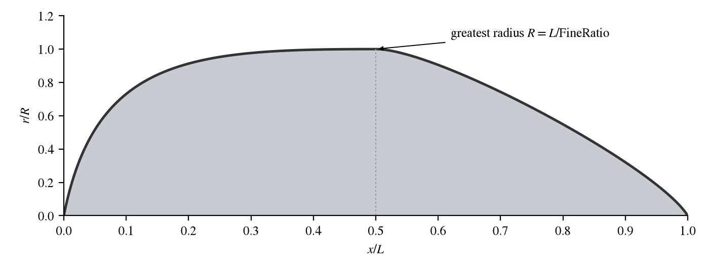

吊舱是最简单的组件：由长度和细长比两个数值确定的流线型回转体。其轮廓固定，头部丰满圆润，
最大直径位于长度中点，尾部逐渐收缩至尖点。它适合快速建立外挂物、油箱、整流罩或占位体。
其他外形可使用[机身或堆叠体](FuselageStack.md)，或[回转体](BOR.md)。

吊舱只有一个专用标签页 Design（设计）。通用的 [Gen](GenTab.md)、[XForm](XFormTab.md)、
[Mass](MassTab.md) 和 [Sub](SubTab.md) 标签页分别见对应帮助。

## 快速开始

1. 添加吊舱。新吊舱长度为 10，头部位于原点，轴线沿 $X$ 方向。
2. 在 XForm 标签页调整位置。
3. 设置 *Length*（长度）。
4. 将 *Fine Ratio* 设为所需长径比的两倍，详见下文。

## 设计

| 控件 | 参数 | 默认值 | 含义 |
|:-----|:-----|:-------|:-----|
| Length（长度） | `Length` | 10 | 从 $X = 0$ 的头部到尾部的长度 $L$。 |
| Fine Ratio（细长比） | `FineRatio` | 15 | 长度与最大半径之比 $L / R$。 |

*Fine Ratio* 是长度除以最大半径，不是通常以直径为分母的长径比。保留此定义是为了使既有模型的
形状不变。长径比等于该值的一半：默认 *Fine Ratio* 为 15 时，直径为 $2L/15$，$L/D = 7.5$。
若所需长径比为 $L/D$，应将 *Fine Ratio* 设为 $2\,L/D$。

最大半径 $R = L / \mathrm{FineRatio}$ 位于长度中点，各种尺寸下的相对轮廓相同（图 1）。
在 $0.05L$ 处半径达到 $R$ 的一半，在 $0.19L$ 处达到 90%；中点之后到 $0.6L$ 仍大于 90%，
在 $0.82L$ 处降至一半，最终在尾部收拢成尖点。改变任一数值时，头部仍在原点；
XForm 标签页的 *Rot Origin(X)* 以长度的比例表示旋转中心位置。

*图 1：吊舱沿长度方向的半径变化，分别以最大半径 R 和长度 L 归一化。*
