[返回目录](index.md)

堆叠几何预设会用一套现成布局替换堆叠几何体的所有截面。在堆叠几何体的“设计”选项卡中，
从“堆叠几何预设”（Stack Preset）下选择预设，然后单击“设置”（Set）；由于原有截面会丢失，
“设置”会先请求确认。除截面及其蒙皮设置外，预设还会设置[截面顺序](FuselageStack.md#section-order)、
端盖，以及短舱预设定义中用到的[发动机模型](EngineModel.md)部分：截面描述的内容、入口和出口的
唇口与端面位置，以及据此构建的几何体。[站位](EngineModel.md#stations)展示了应用短舱预设后
这些控件的状态。预设未使用的发动机模型控件会保留原值，“延伸”（Extension）设置也保持不变。
其中两个预设是简单几何体，一个是新建堆叠几何组件的初始形状，其余十四个是短舱。
发动机建模有许多选项，并非所有组合都能形成有效或实用的模型，因此最好从短舱预设开始建模。

| 预设 | 截面顺序（XSec Order） | 几何类型（Geom Type） | 初始构建结果 |
|:-----|:----------------------|:---------------------|:-------------|
| [默认](#default) | FREE | NONE | 封闭几何体 |
| [带端点的圆柱](#cylinder-with-endpoints) | FREE | NONE | 由自身截面封闭的圆柱 |
| [带端盖的圆柱](#cylinder-with-endcaps) | FREE | NONE | 由平直端盖封闭的圆柱 |
| [出口为原点的贯通短舱](#nacelle-flowthrough-outlet-origin) | LOOP | BOTH | 气流穿过的开放短舱 |
| [入口为原点的贯通短舱](#nacelle-flowthrough-inlet-origin) | LOOP | BOTH | 气流穿过的开放短舱 |
| [中部为原点的贯通短舱](#nacelle-flowthrough-mid-origin) | LOOP | BOTH | 气流穿过的开放短舱 |
| [入口和出口到端面](#nacelle-inlet--outlet-to-face) | FREE | BOTH | 在两端面处封闭的短舱 |
| [入口唇口到出口端面](#nacelle-inlet-lip--outlet-face) | FREE | BOTH | 在入口唇口和出口端面处封闭 |
| [入口端面到出口唇口](#nacelle-inlet-face--outlet-lip) | FREE | BOTH | 在入口端面和出口唇口处封闭 |
| [入口和出口到唇口](#nacelle-inlet--outlet-to-lip) | FREE | BOTH | 在两唇口处封闭 |
| [出口到端面](#nacelle-outlet-to-face) | FREE | OUTLET | 封闭头部，出口在端面处封闭 |
| [出口到唇口](#nacelle-outlet-to-lip) | FREE | OUTLET | 封闭头部，出口在唇口处封闭 |
| [入口到端面](#nacelle-inlet-to-face) | FREE | INLET | 入口在端面处封闭，尾部封闭 |
| [入口到唇口](#nacelle-inlet-to-lip) | FREE | INLET | 入口在唇口处封闭，尾部封闭 |
| [入口和出口流道](#nacelle-flowpath-inlet--outlet) | FREE | BOTH | 从唇口到唇口的管道 |
| [入口流道](#nacelle-flowpath-inlet) | FREE | INLET | 从入口唇口到端面的管道 |
| [出口流道](#nacelle-flowpath-outlet) | FREE | OUTLET | 从出口端面到唇口的管道 |

下图以相同比例展示各预设的初始状态，均沿轴线剖切。构建的曲面以填色显示：正体积为灰色，
负体积为带剖面线的红色。截面在与剖切面上半部相交的位置标有编号，每个截面区间中的箭头从一个
截面指向下一个截面。各图还显示了一个曲面法向、以三维视图中的颜色显示的已启用发动机站位，
以及堆叠几何体的原点。文末的[脚本](#scripting)部分列出了这些预设在 API 中的名称。

## 普通几何体预设

### 默认

新建堆叠几何体采用以下布局：一个点、三个宽 3、高 2.5 的椭圆，再加一个点，分别位于
*X* = 0、1、3、4 和 4.5 处（图 1）。两个点的切线角均为 45 度，因此头部和尾部呈圆滑形状。
使用此预设可恢复新建堆叠几何体的截面布局。

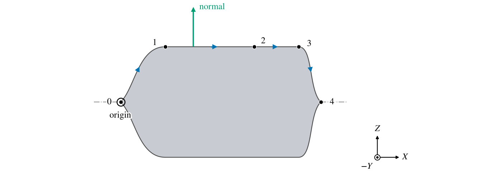

*图 1. 默认预设。*

### 带端点的圆柱

包含四个截面：一个点、两个直径为 2.5 且间距为 3 的圆，再加一个点（图 2）。每个点的 *X*
坐标与对应圆相同，因此两端是属于曲面一部分的平面圆盘。所有截面均未设置蒙皮约束，所以侧面是直的。

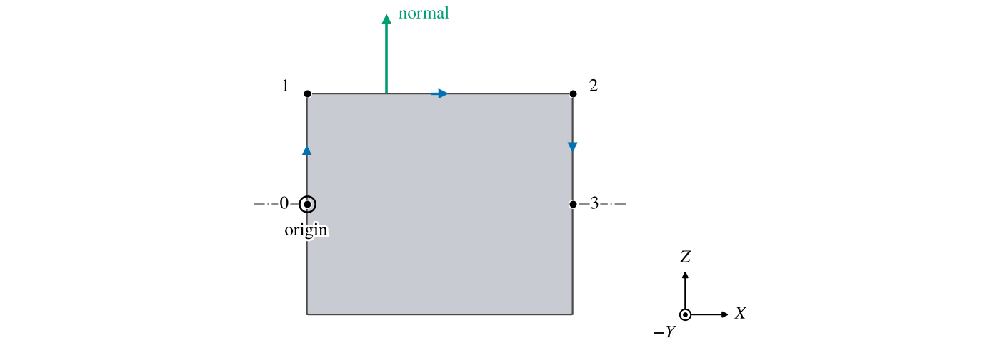

*图 2. 带端点的圆柱预设。*

### 带端盖的圆柱

仅用上述两个圆构建相同的圆柱，并以平直[端盖](FuselageStack.md#end-caps)封闭（图 3）。
侧面是直的，截面未设置蒙皮约束。如果之后可能需要将两端改为圆滑形状，应优先选择此预设而非带端点的圆柱：
端盖类型可以更改，而端点形成的端面会一直保持平直，直到在“蒙皮”选项卡中重新调整其形状。

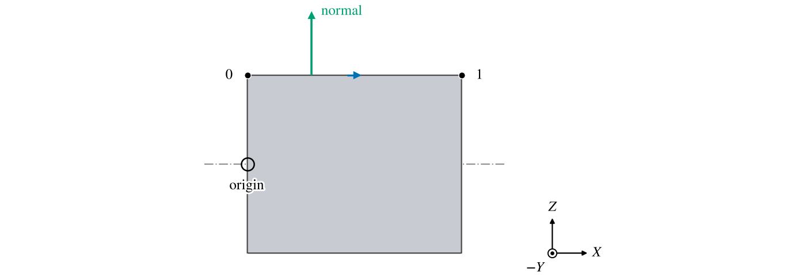

*图 3. 带端盖的圆柱预设。*

## 短舱预设

所有短舱预设均以同一个短舱为基础：最宽处直径为 4，唇口直径为 3，管道直径为 2，
从入口唇口到出口唇口长 6。每个预设描述其中不同的部分，以适应不同分析的需要。

### 发动机定义与表示

发动机模型的设置分为两个步骤，均在堆叠几何体的“设计”选项卡上进行，详见
[发动机模型](EngineModel.md)。

首先，[发动机定义](EngineModel.md#engine-definition)指定截面如何描述发动机。流道可以隐式建模，
即作为 FLOWTHROUGH（贯通）短舱壁的内侧；也可以显式建模为 FLOWPATH（流道），即截面本身
描述流道的管道。随后，[站位](EngineModel.md#stations)在截面上标记入口唇口、入口端面、
出口端面和出口唇口；只启用定义所需的站位。预设按截面索引放置站位。预设不会改变站位是按
*Indx* 还是按 *U* 指定：已经切换为 *U* 的站位会保留旧的 *U* 值，因此在单击“设置”后应将其切回 *Indx*。

其次，[发动机表示](EngineModel.md#engine-representation)指定依据这些截面为分析构建何种几何体。
短舱壁可以保留为正体积，也可以通过 NEGATIVE ONLY（仅负体积）模式舍弃，此类模式只保留流道。
流道可以保持开放，作为未建模的体积；也可以构建为负体积，由 CompGeom、CFD Mesh 及其他支持负体积的
分析从与其重叠的几何体中切除。每一端也可以在完整定义范围以内提前封闭：从完整流道退回到端面，
或从端面退回到唇口；还可以延伸至 CFD 域边界（EXTEND）。
[发动机模型](EngineModel.md#engine-representation)中的图 4 和图 5 展示了贯通短舱的所有表示方式。

### 截面顺序与法向

曲面的外法向由截面顺序决定：当截面沿外侧从前向后排列时，法向指向材料外部。贯通短舱的截面
沿内壁从后向前、沿外壁从前向后排列，形成闭环（图 4–6），因此内壁法向指向管道内部，外壁法向
则背离轴线。添加或移动截面时应保持这一顺序。要检查法向，可将“几何类型”（Geom Type）设置为
NONE，以显示截面自身的曲面；添加一个空白（Blank）子几何体，以 UW 平移和旋转方式附着
（参见[附着到父级](XFormTab.md#attach-to-parent)），然后在曲面上移动它：其 *Z* 轴即为外法向。

### 出口为原点的贯通短舱

三个贯通预设都用一个截面闭环建立整个短舱壁，包括外侧、两端唇口以及内部流道。
其截面顺序（XSec Order）为 LOOP，因此最后一个截面是第一个截面的副本，并与其重合。
初始“入口模式”（Inlet Mode）为 FLOWTHROUGH，保持闭环原样，即气流可以穿过的开放短舱。
FLOWTHROUGH NEGATIVE 会在两端唇口处封闭短舱，并添加从唇口到唇口的负流道，用于贯穿切除
短舱所埋入的其他组件；FLOWTHROUGH NEGATIVE ONLY 则只保留负流道。两端也可以各自独立地
在端面或唇口处封闭，或向外延伸：在“入口模式”中选择相应模式后，出口便采用“出口模式”（Outlet Mode），
这些预设将其设为 TO LIP。

这三个预设仅在闭环起点的位置上不同，该位置也就是堆叠几何体的原点。本预设从出口唇口开始（图 4），
因此短舱位于其原点前方。

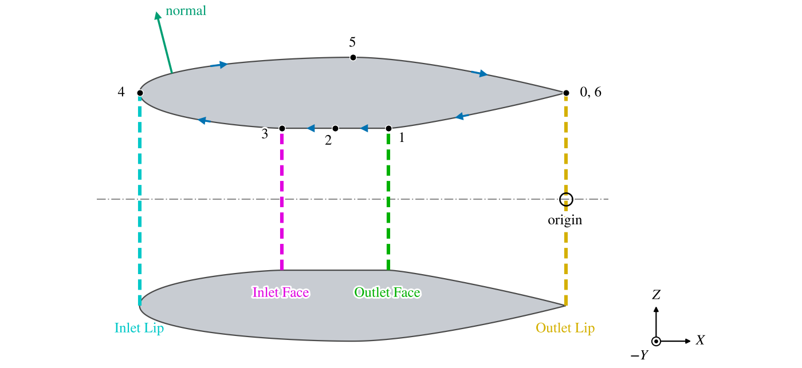

*图 4. 出口为原点的贯通短舱预设：开放短舱。*

### 入口为原点的贯通短舱

从入口唇口开始的贯通短舱（图 5），因此短舱位于其原点后方。

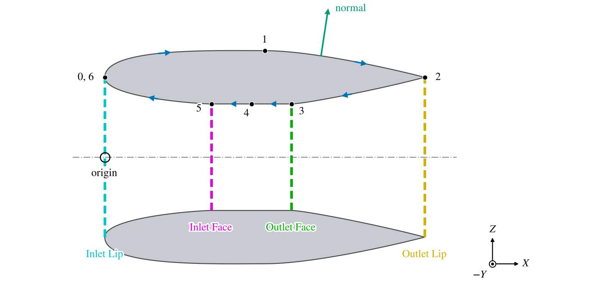

*图 5. 入口为原点的贯通短舱预设。*

### 中部为原点的贯通短舱

从流道中部、两端面之间的中点开始的贯通短舱（图 6），因此原点位于短舱内部。

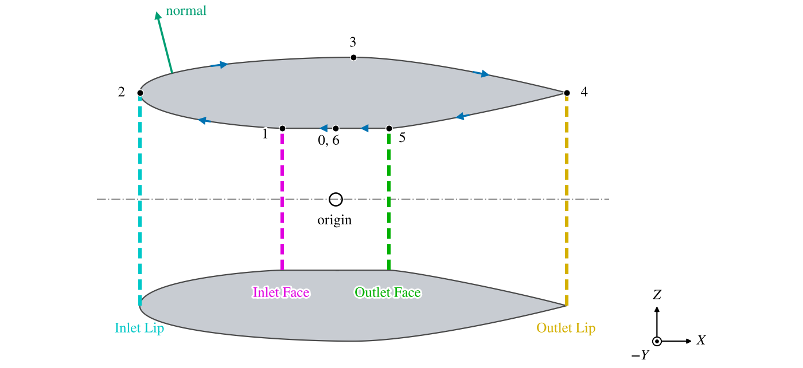

*图 6. 中部为原点的贯通短舱预设。*

### 入口和出口到端面

接下来的四个预设建立短舱外侧，并使每一端止于唇口或端面，再用轴线上的点截面将其封闭。
它们不建立两端面之间的流道。本预设从入口端面开始，绕过入口唇口、沿外侧到达出口端面（图 7）。
初始两端均为 TO FACE，呈开放凹腔；TO FACE NEGATIVE 会在该端唇口处封闭，并将凹腔构建为
负体积；EXTEND 则在唇口处封闭并将其延伸。

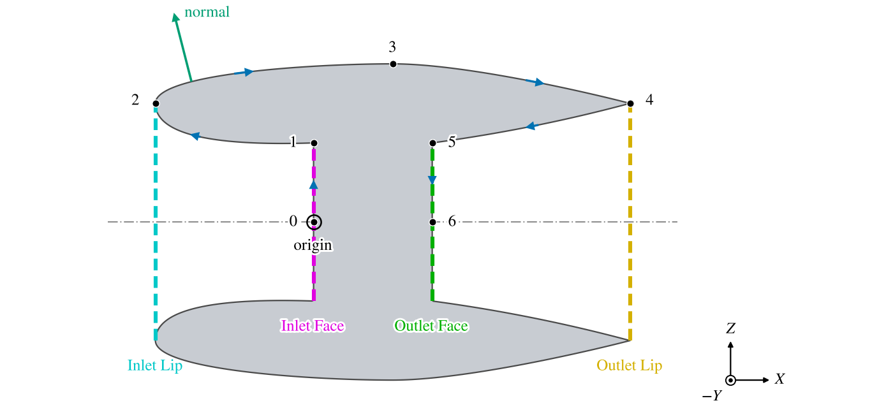

*图 7. 入口和出口到端面预设。原点位于入口端面中心。*

### 入口唇口到出口端面

从已封闭的入口唇口开始，沿外侧到达出口端面（图 8）。出口可以保留为凹腔、构建为负体积或延伸；
入口可以在唇口处封闭或延伸。

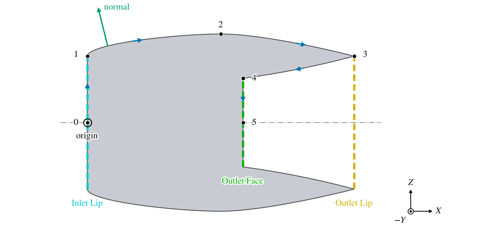

*图 8. 入口唇口到出口端面预设。*

### 入口端面到出口唇口

从入口端面开始，沿外侧到达出口唇口并在此封闭（图 9）。入口可以保留为凹腔、构建为负体积或延伸；
出口可以在唇口处封闭或延伸。

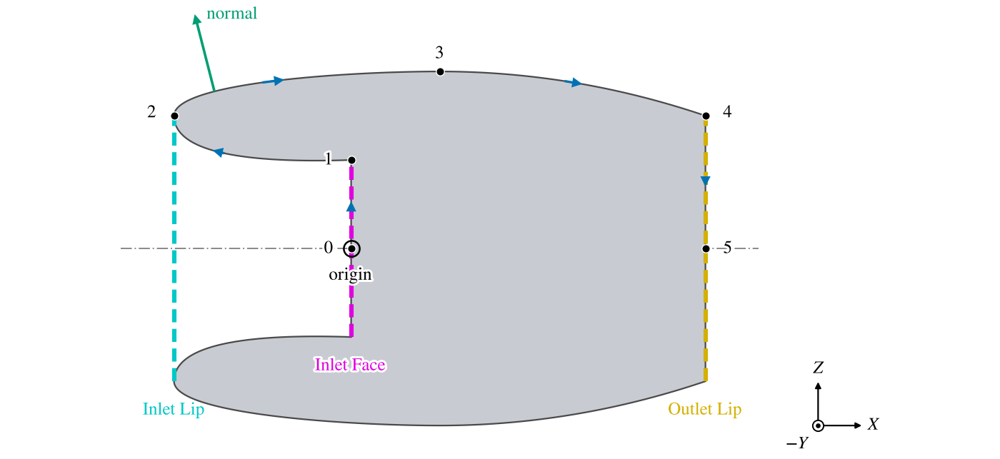

*图 9. 入口端面到出口唇口预设。*

### 入口和出口到唇口

只建立从入口唇口到出口唇口的外侧，并在两端封闭（图 10）。任一端均可延伸。

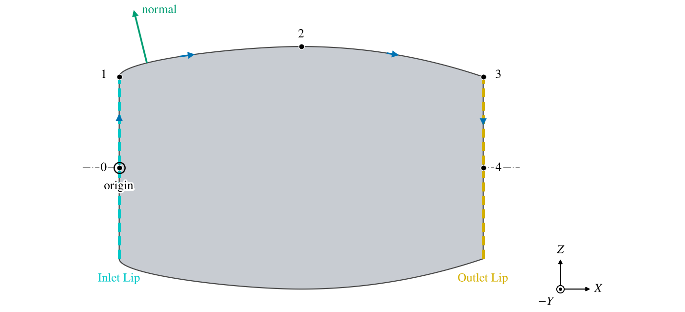

*图 10. 入口和出口到唇口预设。*

### 出口到端面

接下来的四个预设只描述一端，适用于嵌入其他几何体的排气口或进气口。本预设仅建立出口：
封闭且圆滑的头部、外侧，以及延伸到端面的出口（图 11）。出口可以保留为凹腔、构建为负体积或延伸。

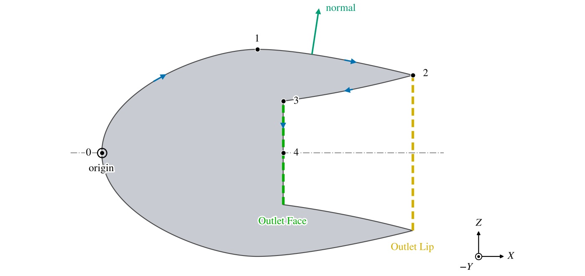

*图 11. 出口到端面预设。原点位于头部。*

### 出口到唇口

只建立出口，在唇口处封闭，前方为封闭头部（图 12）。出口可以延伸。

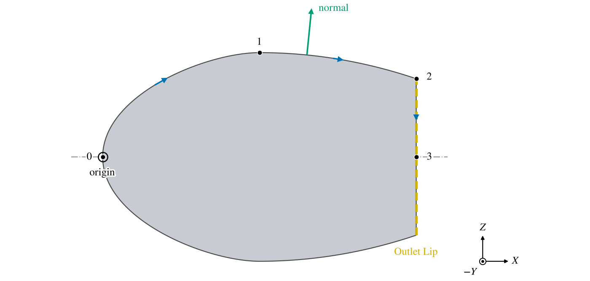

*图 12. 出口到唇口预设。*

### 入口到端面

只建立入口：从入口端面开始，绕过唇口，再沿外侧到达封闭且圆滑的尾部（图 13）。
入口可以保留为凹腔、构建为负体积或延伸。

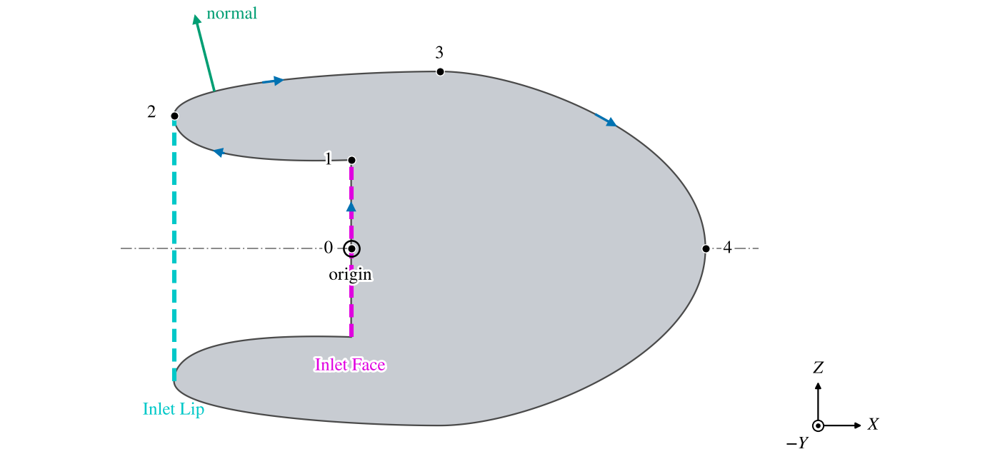

*图 13. 入口到端面预设。原点位于入口端面中心。*

### 入口到唇口

只建立入口，在唇口处封闭，后方为封闭尾部（图 14）。入口可以延伸。

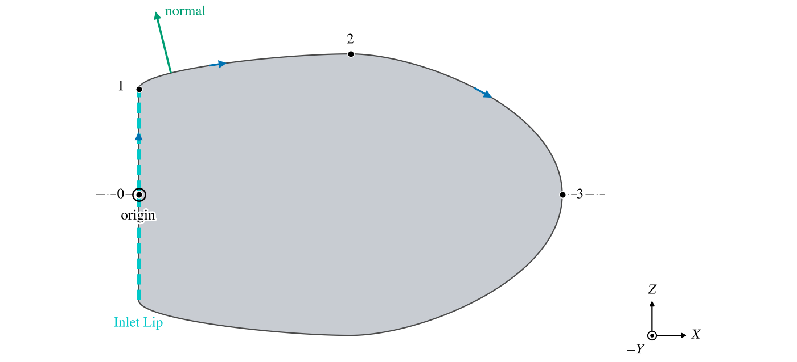

*图 14. 入口到唇口预设。*

### 入口和出口流道

最后三个预设将流道显式建模为管道，不建立周围的任何短舱结构。其截面顺着气流从入口向出口排列，
与贯通短舱内侧的截面顺序相反；管道每一端均由唇口处的点截面封闭。可用它们从所埋入的机身或机翼中
切出管道，也可以建立管道本身的模型。

本预设建立完整管道（图 15）：从入口唇口开始，经过入口端面和管道，到达出口端面及出口唇口。
初始两种模式均为 TO LIP，按截面所描述的形状将管道构建为正体积。“入口模式”（Inlet Mode）
为 FLOWTHROUGH NEGATIVE 或 FLOWTHROUGH NEGATIVE ONLY 时，会将整个管道构建为负体积；
TO FACE NEGATIVE 则只将入口唇口到入口端面的部分构建为负体积。此时，“出口模式”（Outlet Mode）
可以使出口在唇口处封闭、将其延伸，或采用 TO FACE NEGATIVE 将出口端面到出口唇口的部分构建为
负体积。参见[流道的表示](EngineModel.md#representing-a-flowpath)。

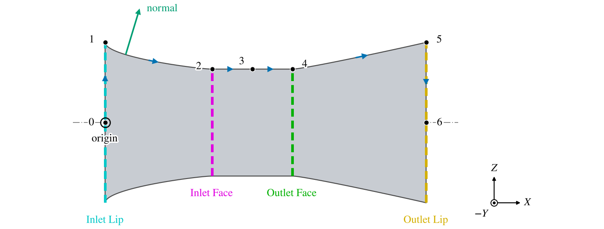

*图 15. 入口和出口流道预设：一条管道。原点位于入口唇口中心。*

### 入口流道

只建立从入口唇口到入口端面的入口管道（图 16）。初始“入口模式”（Inlet Mode）为 TO LIP，
将管道构建为正体积。TO FACE NEGATIVE 将其构建为负体积，EXTEND 则将其构建为正体积并向上游延伸。

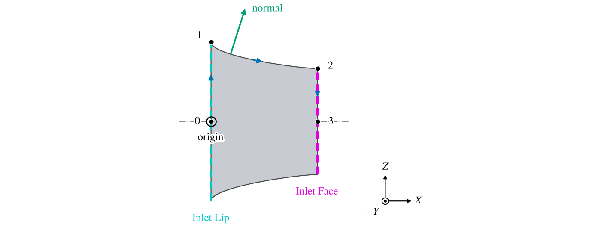

*图 16. 入口流道预设：一条管道。*

### 出口流道

只建立从出口端面到出口唇口的出口管道（图 17）。初始“出口模式”（Outlet Mode）为 TO LIP，
将管道构建为正体积。TO FACE NEGATIVE 将其构建为负体积，EXTEND 则将其构建为正体积并向下游延伸。

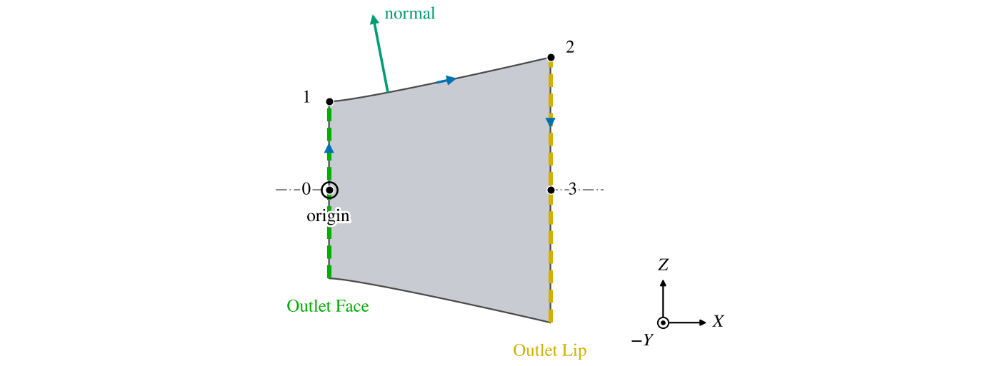

*图 17. 出口流道预设：一条管道。原点位于出口端面中心。*

## 脚本

`InitStackPreset( stack_id, preset )` 会像“设置”（Set）一样将预设应用于堆叠几何体，但不会请求确认；
调用后需执行 `Update()`。

| 预设 | `preset` |
|:-----|:---------|
| 默认 | `STACK_PRESET_DEFAULT` |
| 带端点的圆柱 | `STACK_PRESET_CYLINDER_ENDPTS` |
| 带端盖的圆柱 | `STACK_PRESET_CYLINDER_ENDCAPS` |
| 出口为原点的贯通短舱 | `STACK_PRESET_FLOWTHRU_OUTLIP_ORIG` |
| 入口为原点的贯通短舱 | `STACK_PRESET_FLOWTHRU_INLIP_ORIG` |
| 中部为原点的贯通短舱 | `STACK_PRESET_FLOWTHRU_MID_ORIG` |
| 入口和出口到端面 | `STACK_PRESET_BOTHFACEFACE` |
| 入口唇口到出口端面 | `STACK_PRESET_BOTHLIPFACE` |
| 入口端面到出口唇口 | `STACK_PRESET_BOTHFACELIP` |
| 入口和出口到唇口 | `STACK_PRESET_BOTHLIPLIP` |
| 出口到端面 | `STACK_PRESET_OUTFACE` |
| 出口到唇口 | `STACK_PRESET_OUTLIP` |
| 入口到端面 | `STACK_PRESET_INFACE` |
| 入口到唇口 | `STACK_PRESET_INLIP` |
| 入口和出口流道 | `STACK_PRESET_FLOWPATH_BOTH` |
| 入口流道 | `STACK_PRESET_FLOWPATH_IN` |
| 出口流道 | `STACK_PRESET_FLOWPATH_OUT` |
