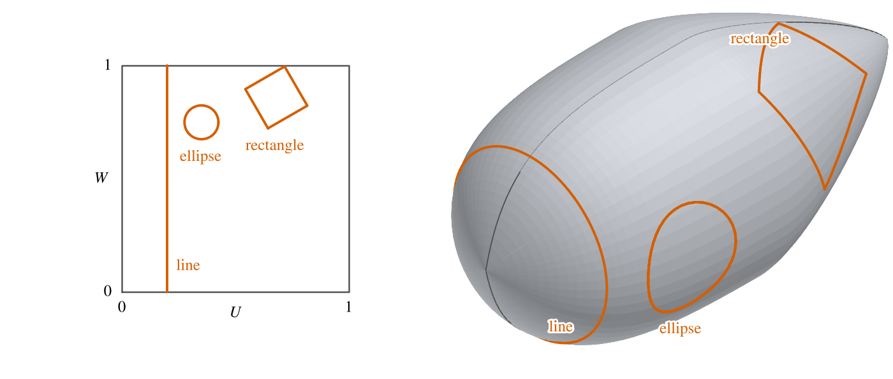
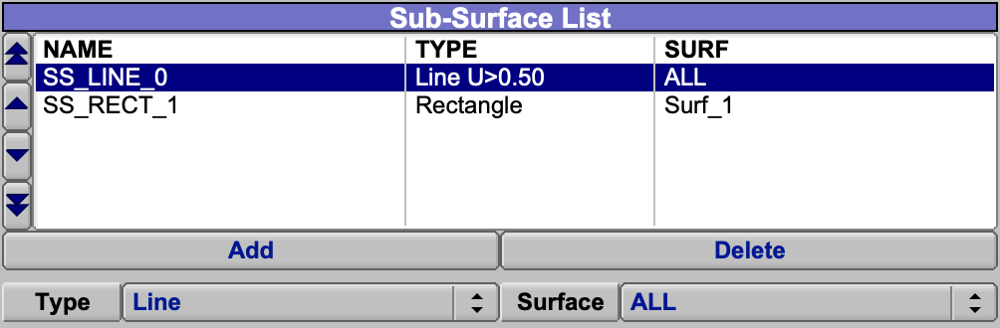
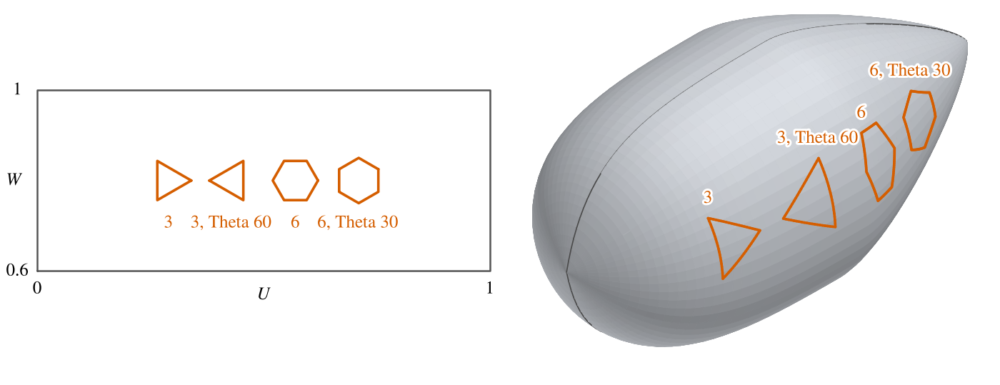
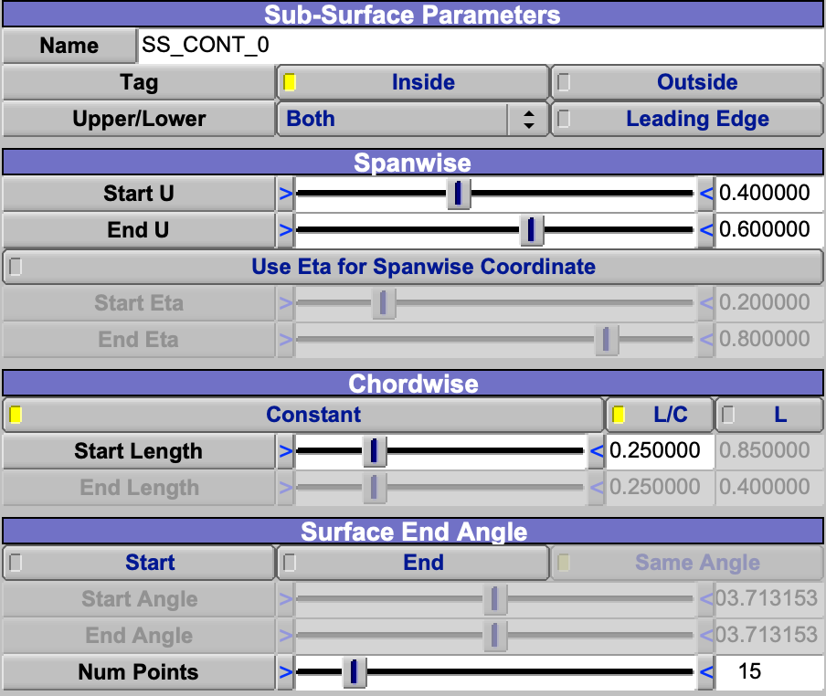
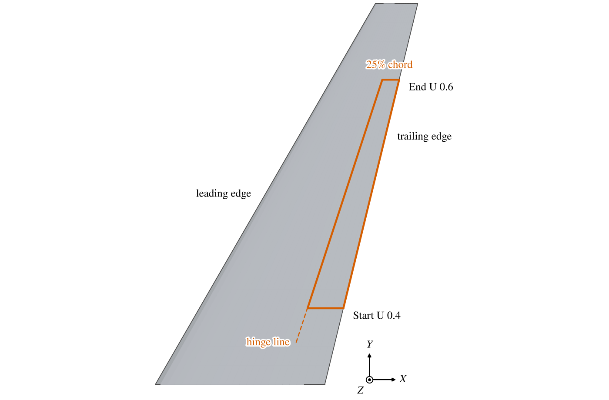
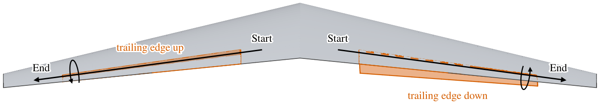

OpenVSP 的组件（Geom）编辑窗口具有相同的前几个选项卡：[Gen](GenTab.md)、[XForm](XFormTab.md)、[Mass](MassTab.md) 和 Sub。Sub 管理组件的子曲面。Blank、Hinge、Human、Mesh、NGon Mesh、Point Cloud、Routing 和 Wireframe 没有 Sub 选项卡。

| 主题 |
|:-----|
| [子曲面](#sub-surfaces) |
| [子曲面类型](#sub-surface-types) |
| [控制面](#control-surface) |
| [铰链线与偏转](#hinge-line-and-deflection) |
| [脚本](#scripting) |

## 子曲面

子曲面在组件曲面上标记一个区域或一条线。它不改变形状，而是标记其中一部分，让分析能单独处理：

- CompGeom 和网格导出标记区域内的三角形，以单独报告面积并在导出网格中保留标签。
- VSPAERO 可偏转控制面（仅 Control_Surf 类型）；各对称副本在其中分别作为控制面。
- Parasite Drag 可对该区域采用独立处理方式，或不计阻力。
- 开启默认的 *Intersect Sub-Surfaces* 时，CFD Mesh 和 FEA Mesh 将子曲面边界压印到网格；FEA Structure 可将其转成梁单元或移除其壳单元。
- STEP、IGES 导出可沿子曲面分割曲面，DegenGeom 也会报告子曲面。

子曲面使用曲面自身参数定义：U 沿组件纵向，W 绕组件周向，范围均为 0 至 1，起点见[附着坐标](XFormTab.md#attachment-coordinates)。因此组件变形时，子曲面仍位于曲面的相同参数区域；U-W 平面中的矩形在曲面上未必呈矩形（图 1）。区域用 *Tag* 的 *Inside* 或 *Outside* 选择标记边界内侧或外侧。对于 Line，*Test* 的 *Greater* 标记 U（或 W）较大的一侧，*Less* 标记另一侧。

*图 1. U 0.2 处的 Line、旋转 Theta 30 的 0.2 × 0.2 Rectangle，以及 0.15 × 0.15 Ellipse，分别显示于 U-W 平面（左）及吊舱上（右）。*

点击 *Add* 前先选 *Surface*：*ALL* 将子曲面加到组件的每个曲面，例如螺旋桨的所有桨叶；*Surf_i* 只加到指定曲面（图 2）。此选择在创建时生效，Sub 选项卡之后不能修改。某曲面上的子曲面也会出现在该曲面的全部对称副本上。

*图 2. 默认 Propeller 的 Sub 顶部，包含以 Surface ALL 添加的 Line，以及以 Surface Surf_1 添加的 Rectangle。SURF 列显示各子曲面所属曲面。*

每个子曲面有自己的名称（成为标签的一部分）和属性，参见[属性](GenTab.md#attributes)。

## 子曲面类型

| 类型 | 定义方式 | 用途 |
|:-----|:---------|:-----|
| Line | 横跨整个曲面的恒 U 或恒 W 线，标记其中一侧。 | 按站位或纵向分割体部。 |
| Rectangle | 中心、U/W 长度及从 U 朝 W 方向的转角 *Theta*。 | 面板或舱口。 |
| Ellipse | 中心、U/W 长度（直径）、*Theta* 及轮廓点数。 | 窗口或入口端面。 |
| Finite_Line | U-W 平面中两点之间的直线段，不标记区域。 | 网格中的线或 FEA 梁。 |
| XSec_Curve | 任意截面曲线（圆、超椭圆、编辑曲线等），以 U/W 定位中心，宽度沿 U、高度沿 W。 | 任意形状的轮廓。 |
| Intersect | 其他组件与本组件相交的曲线。 | 部件在体部上的相交轮廓。 |
| Control_Surf | 展向起止站位及从边缘量取的弦向深度，见下文；仅用于 Wing 和 Propeller。 | 襟翼、副翼、前缘缝翼。 |

Rectangle 和 Ellipse 的长度及 *Theta* 作用在 U-W 平面。在细长体上，0.2 × 0.2 的“正方形”沿纵向的实际长度可能远大于周向长度；*Theta* 也不是曲面上的实际夹角。

Line 默认用 *[0, 1]* 表示曲面 U（或 W）范围的比例。选择 *[0, N]* 则按截面计数，整数使线恰好位于截面上：Fuselage 的 U 2 是第三个截面；Wing 的根部和翼尖端盖也算截面，因此 U 1 是翼根翼型，U 2 是第一翼段末端。W 按每截面的四个四分之一段计数；Wing 的 W 2 为前缘，此处的恒 W 线将上、下表面分开。其他组件 W 的起点见[附着坐标](XFormTab.md#attachment-coordinates)。线需要位于特定截面时应使用 [0, N]：在其后增加截面时仍留在该截面，而 [0, 1] 比例值会移动到截面间的新位置。

Ellipse 实际绘制为具有 *Num Points* 个顶点的多边形，因此较小点数可生成多边形：3 为三角形，6 为六边形（图 3）。第一个顶点与 U 方向夹角为 *Theta*，所以 Theta 0 时有一个角朝向 U。N 个点时，将 Theta 设为 180/N 度可旋转半条边对应的角度，使一条边朝向 U。数值输入框支持算式，可直接输入 180/6。U、W 长度相等时，在 U-W 平面得到正多边形；与 Rectangle 一样，只有 U 和 W 缩放比例相同时，曲面上的多边形才是正多边形。

*图 3. Num Points 为 3 和 6 的 Ellipse，分别取 Theta 0 和 Theta 180/N，在 U-W 平面（左）及吊舱上（右）的形状。*

XSec_Curve 初始为直径 1 的圆，会跨越整个曲面，因此应先调整尺寸。宽高分别为 U、W 范围的比例，从 0 至 1。

Intersect 在点击 *Intersect* 时，根据 *Intersect Geom* 选择的组件计算相交曲线，并作为编辑曲线保存。若两个组件形成多条相交曲线，用 *Curve Index* 从 *Num Curves* 条曲线中选择。它不会自动跟随后续几何变化；修改组件后应再次点击 *Intersect*。两次计算之间，它就是普通的 XSec_Curve 轮廓，可编辑或更换曲线类型，整理或简化轮廓。

## 控制面

Wing 和 Propeller 提供 Control_Surf 类型（图 4）。它在 *Upper*、*Lower* 或 *Both* 表面上标记由后缘（勾选 *Leading Edge* 则为前缘）、两个展向站位和铰链线围成的区域。襟翼、副翼、升降舵和方向舵应使用此类型，而不是 Rectangle：Rectangle 虽可做出类似外观，其边界却沿 U/W 而非按边缘深度定义，且 VSPAERO 只偏转 Control_Surf。

*图 4. 默认机翼的默认控制面：Start U 0.4 至 End U 0.6，恒定深度为弦长的 0.25，位于 Both 表面。当前选项未使用的控件为灰色。*

- 展向站位为 *Start U* 和 *End U*；开启 *Use Eta for Spanwise Coordinate* 后使用 *Start Eta* 和 *End Eta*，即从翼根到翼尖的展长比例（螺旋桨为半径比例 $r/R$，参见[展向坐标 Eta](Wing.md#spanwise-coordinate-eta)）。U 包含翼根和翼尖端盖，见[附着坐标](XFormTab.md#attachment-coordinates)，因此单翼段机翼默认 U 0.4 至 0.6 对应展长的 20% 至 80%（图 5）。
- 在起端和末端分别给出弦向深度，可使用局部弦长比例（*L/C*）或长度（*L*）；*Constant* 使末端等于起端。各表面上的铰链线经过距边缘为指定直线距离的点。
- 两侧边界默认沿机翼截面；*Surface End Angle* 可指定每侧与边缘的夹角，单位为度。两角均启用时，*Same Angle* 使末端角等于起端角。未指定某侧角度时，其滑块显示截面与边缘的实际夹角。
- 两侧边界和铰链线均由四点拟合为光滑曲线：两端点和两个三等分点。深度与端部角度在这些点精确满足，在其间平滑过渡。*Num Points* 控制每条边的绘制点数，进而影响标签区域贴合曲线的精细程度。控制面较长或设置了端角且需要平滑轮廓时，应增加点数。

*图 5. 默认机翼的默认控制面，Start U 0.4 至 End U 0.6，深度为弦长的 25%，位于上下两面。虚线为铰链线。*

### 铰链线与偏转

三维视图从 Start 端到 End 端绘制各控制面的铰链线，并用弧形箭头表示正偏转方向。正偏转按沿 Start 指向 End 的铰链线的右手规则旋转。机翼 Start 位于翼根时，后缘控制面向下偏，前缘控制面向上偏。

对称副本是镜像，其铰链线也从翼根指向翼尖，因此同样的正偏转会使该副本后缘向上（图 6）。VSPAERO 对各副本施加“控制组偏转角 × 该副本增益”的偏转。自动分组将两个副本放在同一组，各自增益均为 1，得到副翼式反向偏转。襟翼或升降舵需要同向偏转时，应将副本增益设为 -1。

*图 6. 从后方观察默认机翼控制面及其对称副本，两者均施加同样的正偏转，$+Y$ 向右。铰链线从 Start 指向 End；弧形箭头标示正方向；虚线轮廓是未偏转状态。*

## 脚本

本选项卡的各控件均为参数，可按名称和参数组用 `SetParmVal`、`GetParmVal` 读写。`GetParmActiveFlag` 返回上一次 Update 时控件是激活还是灰色禁用状态。

用 `AddSubSurf( geom_id, type, surfindex )` 创建子曲面。曲面索引默认 0，即第一个曲面；传入 -1 表示全部曲面，与 Sub 的 *ALL* 相同。`GetSubSurfIDVec` 列出组件子曲面，`GetSubSurfParmIDs` 返回子曲面参数，`IntersectSubSurf` 执行 *Intersect* 按钮的操作，相交组件由 `SetIntersectSubSurfGeomID` 指定。

| 控件                          | 参数                                                       | 参数组       |
|:------------------------------|:-----------------------------------------------------------|:-------------|
| Sub-surface Tag               | `Test_Type`: `INSIDE`, `OUTSIDE` or `NONE`                 | SS_Rectangle, SS_Ellipse, SS_XsecCurve 或 SS_Control，按类型选择 |
| Line value, [0, 1] or [0, N]  | `Const_Line_Value`, `Const_Line_Value0N`; `Value_01` 1 表示 [0, 1]，0 表示 [0, N] | SubSurface |
| Line sub-surface Test         | `Test_Type`: `SS_LINE_TEST_GREATER`, `SS_LINE_TEST_LESS` or `SS_LINE_TEST_NONE` | SubSurface |
| Control surface sides         | `Surf_Type`: `SS_CONTROL_UPPER_SURF`, `SS_CONTROL_LOWER_SURF` or `SS_CONTROL_BOTH_SURF` | SS_Control |
| Line Type                     | `Const_Line_Type`: `CONST_U` or `CONST_W`                  | SubSurface   |
| Center U, Center W            | `Center_U`, `Center_W`                                     | SS_Rectangle, SS_Ellipse or SS_XsecCurve |
| U Length, W Length, Theta     | `U_Length`, `W_Length`, `Theta`                            | SS_Rectangle or SS_Ellipse |
| Ellipse Num Points            | `Tess_Num`                                                 | SS_Ellipse   |
| Finite_Line ends              | `UStart`, `UEnd`, `WStart`, `WEnd`                         | SS_FiniteLine |
| Start U, End U                | `UStart`, `UEnd`                                           | SS_Control   |
| Use Eta, Start Eta, End Eta   | `EtaFlag`, `EtaStart`, `EtaEnd`                            | SS_Control   |
| Leading Edge                  | `LE_Flag`                                                  | SS_Control   |
| Chordwise L/C or L            | `Abs_Rel_Flag`: `REL` or `ABS`                             | SS_Control   |
| Start and End depth           | `Length_C_Start`, `Length_C_End` (L/C); `Length_Start`, `Length_End` (L) | SS_Control |
| Constant                      | `SE_Const_Flag`                                            | SS_Control   |
| Surface End Angle             | `StartAngleFlag`, `EndAngleFlag`, `SameAngleFlag`, `StartAngle`, `EndAngle` | SS_Control |
| Control surface Num Points    | `Tess_Num`                                                 | SS_Control   |
