Fuselage、Stack、Wing 和 Propeller 通过一系列截面放样成形。XSec 选项卡用于增删、复制截面并设置形状。Fuselage 和 Stack 的 Skinning 选项卡进一步控制曲面到达或离开各截面时的角度、保持该角度的强度以及曲率，分别作用于截面前后两侧、截面周围四个方位及其他指定点。截面形状参见[截面曲线](XSecCurves.md)和[翼型](Airfoils.md)。

| 主题 | 选项卡 |
|:-----|:-------|
| [截面操作](#working-with-sections) | XSec |
| [曲面的放样方式](#how-the-surface-is-lofted) | Skinning |
| [控制站位：四侧与脊线](#stations-sides-and-spines) | Skinning |
| [角度](#angle) | Skinning |
| [偏斜](#slew) | Skinning |
| [强度](#strength) | Skinning |
| [曲率](#curvature) | Skinning |
| [前后两侧与连续性](#left-right-and-continuity) | Skinning |
| [设置、相等与对称](#set-equal-and-symmetry) | Skinning |
| [脊线](#spines) | Skinning |
| [以截面曲线确定角度基准](#angle-basis-from-curve) | Skinning |
| [显示与清除蒙皮条件](#showing-and-clearing-skinning) | Skinning |
| [建议](#advice) | |
| [脚本](#scripting) | |

## 截面操作

XSec 顶部箭头选择当前截面，下方控件均作用于它。截面从 0 编号，起于 Fuselage/Stack 的前端、Wing 的翼根或 Propeller 的桨毂。别名字段为截面及其曲线命名，名称显示在参数选择器和 API 中。

| 控件 | 作用 |
|:-----|:-----|
| Insert | 在当前截面之后添加其副本，并选中新副本。 |
| Cut | 删除当前截面并保留供粘贴。组件至少保留两个截面。 |
| Copy | 复制当前截面供粘贴。 |
| Paste | 用复制的截面替换当前截面，保留当前位置。 |
| Choose Type | 改变当前截面形状，参见[选择形状](XSecCurves.md#choosing-a-shape)。 |
| Convert CEDIT | 转为相同形状的可编辑曲线，参见[编辑曲线](XSecCurves.md#edit-curve)。 |

粘贴会保留被替换截面的位置：Fuselage 保留位置但不保留旋转和 Spin；Stack 保留步进、转角、Coord System、Spin 和 V Align；Propeller 保留半径。

插入副本通常位于当前截面与下一截面之间：Fuselage 取两者 X 位置中点，Propeller 取半径平均值。Stack 采用相对前一截面的位置，因此副本沿用当前截面的偏移（若当前截面 X 偏移为零，则取 X 方向 1），后续截面随之移动相同距离。只有顺序策略为 FREE 的 Stack 才可在最后一个截面之后插入，参见[机身与堆叠几何体](FuselageStack.md)。

截面可复制到同类组件，例如 Fuselage 到 Fuselage；粘贴到不同类型时只复制曲线。Wing 的这些控件位于 Sect 选项卡，但 Insert 插入的是已复制的截面，而不是当前截面的副本；Airfoil 选项卡仅复制粘贴翼型，参见[机翼](Wing.md)。

## 曲面的放样方式

曲面经过每个截面。相邻截面之间，一个截面曲线上的点连接到下个截面同参数位置的点，曲线参数绕截面一周，参见[截面曲线](XSecCurves.md#how-a-section-is-laid-out)。每条纵向线都是穿过截面的光滑曲线，彼此独立构建。

未指定其他条件时，两截面之间为直线。Fuselage/Stack 的 Skinning 在截面处添加条件：曲线到达或离开截面时的一阶导数方向和长度，以及二阶导数。条件设在截面周围的若干控制站位，再沿周向平滑插值。

每条线在两截面间是一个多项式，两端每增加一个条件，其次数增加一级（图 1）。无条件时是直线；一端指定角度时成为只能向一侧弯曲的抛物线；两端指定角度时成为三次曲线，可先弯再反弯，在不同尺寸截面之间形成 S 形；两端再指定曲率则达到该段可承载的最高五次。因此，段的弯曲复杂度取决于条件，需要什么形状就设置多少条件。例如要使曲面离开前截面及到达后截面时均平行于轴线，应在两端都约束角度。

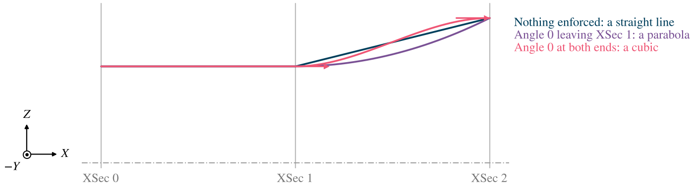

*图 1. 圆截面 Stack 的顶部纵向线，截面间距 2，末截面直径由 2 改为 3；只在 XSec 1 到 XSec 2 的段上设置条件。箭头为约束方向。*

整个体部生成一个未裁剪曲面。U 沿纵向，每个截面间段占相同参数份额，与实际长度无关；W 绕截面一周。Point 截面处所有 W 汇聚于一点。U/W 也是其他组件附着到体部使用的坐标，参见[附着坐标](XFormTab.md#attachment-coordinates)。

下文方向均沿体部朝后续截面测量。截面的 *left*（左侧）指它与前一截面之间的曲面，*right*（右侧）指它与后一截面之间的曲面，不要与截面周向的 Left/Right 方位混淆。

## 控制站位：四侧与脊线

每个截面有四个方位站位：*Right*、*Bottom*、*Left*、*Top*，对应曲线参数 0、0.25、0.5、0.75（图 2）。Fuselage/Stack 截面未旋转时，Right 朝 $+Y$，Top 朝 $+Z$。XSec 的 *Spin* 改变曲线起点，四侧随之移动。*Sides* 设置这四处的蒙皮条件。

*Spines* 可在截面周围任意位置增加站位，参见[脊线](#spines)。脊线可左右镜像、上下镜像或同时镜像，每个镜像位置均增加站位。

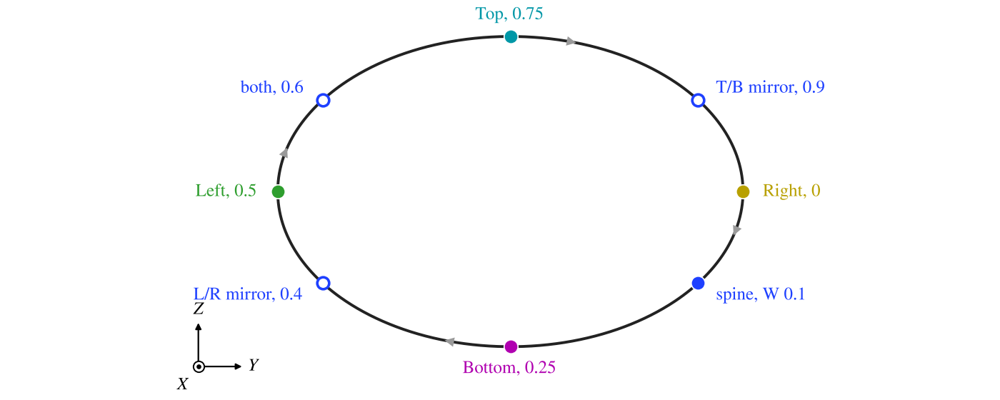

*图 2. 截面四侧及 W 0.1 的脊线和三个镜像，颜色与三维视图一致，箭头表示曲线参数递增方向。*

站位之间的各量沿截面插值，并保持在两侧站位数值之间，不会过冲。因此，一个站位只影响至相邻站位之间的曲面。

## 角度

*Angle* 以度为单位，使曲面方向朝向或远离体部轴线。0 表示沿轴线；朝后续截面前进时，正角向外、远离轴线，负角向内（图 3）。角度在通过轴线和站位的平面内测量，因此 Top 角使曲面上下倾斜，Right 角使其侧向倾斜。

Point 截面处，角度决定端部钝度：0 使曲面沿轴线离开该点，形成尖端；90 使其垂直轴线离开，形成圆钝端。新建 Fuselage/Stack 的首末点截面分别使用 45 和 -45 度，使头尾圆滑。

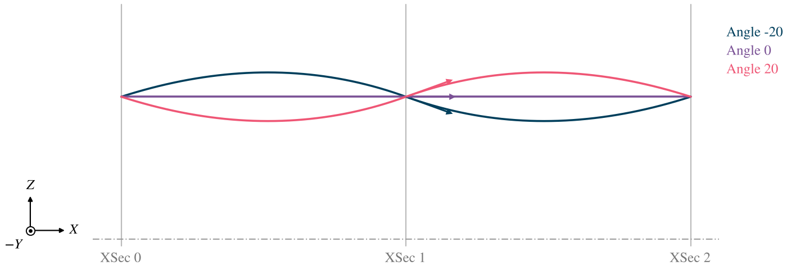

*图 3. 三个相等圆截面、间距 2 的 Stack，中截面前后两侧 Top Angle 均取 -20、0、20。箭头为离开截面的方向，点划线为轴线；首末截面不施加条件。*

## 偏斜

*Slew* 以度为单位使曲面方向绕截面转动，而非朝轴线倾斜，即在离开站位时产生扭偏。其正方向依方位而异，以便对称开关产生镜像而非整体扭转：Top 和 Bottom 的正 Slew 朝 Right，Right 和 Left 的正 Slew 朝 Bottom。脊线的正 Slew 沿曲线参数递增方向，即图 2 的下一站位方向；左右或上下单独镜像时方向相反，同时镜像时方向相同。

Slew 与 Angle 一同施加，没有独立 Set 开关。

## 强度

*Strength* 是曲面到达或离开截面时的一阶导数长度，表示曲面保持既定角度多远后转向下一截面（图 4）。其单位基准为到较近相邻截面的距离；计算时不仅考虑中心间距，也计入宽度或高度变化的一半。因此 Strength 1 大致相当于等距截面间直线的一阶导数；更大值使角度保持更久、曲面更鼓，更小值允许更早转弯。

Strength 与 Angle 一同施加，没有独立 Set 开关。

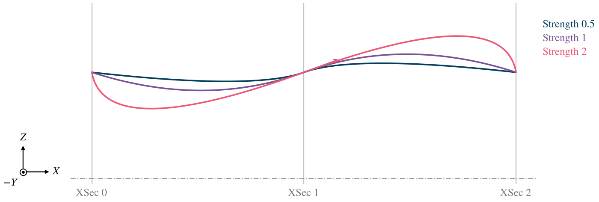

*图 4. 同一 Stack，中截面 Top Angle 为 20，Strength 分别为 0.5、1、2。*

## 曲率

*Curvature* 设置曲面到达或离开截面时的二阶导数，位于角度测量平面内，单位基准与 Strength 相同（图 5）。正值使曲面弯向远离轴线方向，因此截面位于收腰处；负值使曲面弯向轴线，因此截面处形成局部鼓起。它有独立 Set 开关。

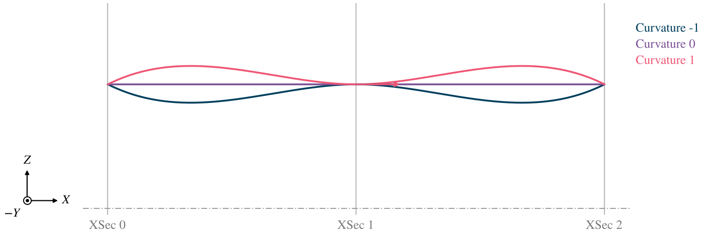

*图 5. 同一 Stack，中截面 Top Angle 0、Strength 1，Curvature 分别为 -1、0、1。*

## 前后两侧与连续性

每个量都有左、右值，对应截面前后两段曲面。两侧不一致时，可在截面处形成转折或折痕（图 6）。

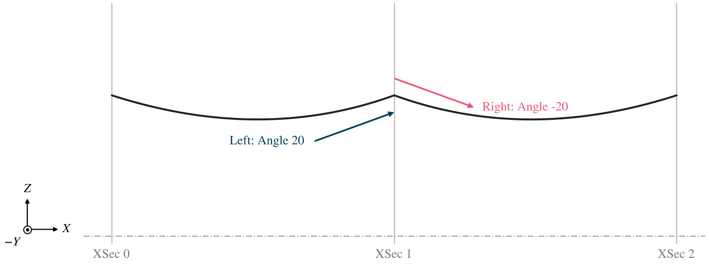

*图 6. 中截面左侧 Top Angle 20、右侧 -20，在截面处形成脊。*

*Enforce* 指定连续性，决定两侧是否必须一致；它在 Top 方位的标题栏设置，对整个截面生效。*C0* 不要求两侧一致；*C1* 要求方向与一阶导数连续，右值跟随左值，未约束角度处也使两侧平滑相接；*C2* 进一步要求曲率连续。图 7 未施加蒙皮条件时，C0 使两侧直线相接而产生折角，C1/C2 则平滑通过。首末截面只有一侧曲面，因此始终为 C0。

未设置角度时，C1 必须弯曲相邻两段之一来使其相接：优先选择条件较少的段，条件数相同时选择截面之前的段，另一段保持不变。图 7 中，C1 使中截面之前的段下垂，低于两个相同尺寸的截面，而之后的段仍直；C2 则使两段都弯曲。不指定具体形状时，连续性可快速得到光滑体部；要主动控制形状时，应设置角度并保持 C0，由设置而非放样算法决定哪里弯曲。

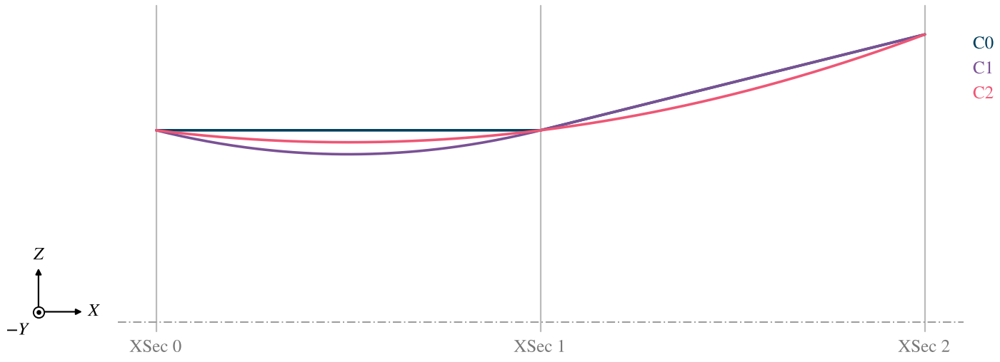

*图 7. 未施加蒙皮条件时中截面的连续性，末截面直径由 2 改为 3。*

首截面没有左侧曲面，但离开它的曲面使用的是 *left* 值，right 值不使用。末截面也用 left 值设置到达它的曲面。

## 设置、相等与对称

各量的行中，两侧各有 *Set* 开关，中间有 *=*。Set 开启时施加该值；关闭时该值不是输入，OpenVSP 显示曲面在该站位的实际结果，因此滑块显示算法算出的角度、强度和曲率。开启 Set 就锁定这些值，然后可继续调整。

每个站位的开关独立：可约束 Top 角而让 Right 自由，后者跟随放样结果。只有连续性是整个截面共享的。

= 使右值等于左值。开关也受连续性影响：C1 及以上时，右侧角度、Slew、Strength 始终等于左侧；C2 时曲率也相等。

标有量名称（Angle、Slew 等）的按钮是左值的参数按钮，可用于参数链接或设为设计变量；旁边的小空白按钮对应右值。

*Sides* 的对称开关复制完整蒙皮设置：*All Sym* 将 Top 复制到四侧，*T/B Sym* 从 Top 复制到 Bottom，*R/L Sym* 从 Right 复制到 Left。它们保证设置对称，不直接保证曲面对称；截面形状、位置、旋转和相邻截面也对称时，曲面才对称。

新建 Fuselage/Stack 默认开启 T/B Sym 和 R/L Sym，连续性 C0，不设置曲率（图 8）。中间截面约束 Angle 0 并开启 =，使体部经过各截面时平行于轴线；两侧 Strength 均为 1，但不以 = 相连，可分别修改。首末为[角度](#angle)一节所述点截面。

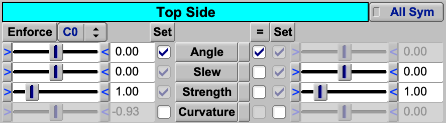

*图 8. 新建 Fuselage 的截面 1 Top 方位：约束 Angle 0，= 开启使右值跟随左值；Slew 和 Strength 随 Angle 一同约束，但两侧独立；Curvature 自由，显示放样得到的值。*

## 脊线

脊线是自行添加的站位，以截面周向曲线参数 *W*（0 至 1）定位（图 2）。*Add* 在站位之间最大间隔的中点添加脊线，初始不施加条件，数值取现有曲面结果，因此添加时曲面变化很小。*Delete* 和 *Delete All* 删除脊线。列表下方控件编辑选中脊线（图 9）。*L/R Sym*、*T/B Sym* 添加左右、上下镜像站位，采用相同蒙皮设置。若脊线或镜像与其他站位的 W 距离小于 0.00025，则忽略该重合站位；四侧站位始终优先。

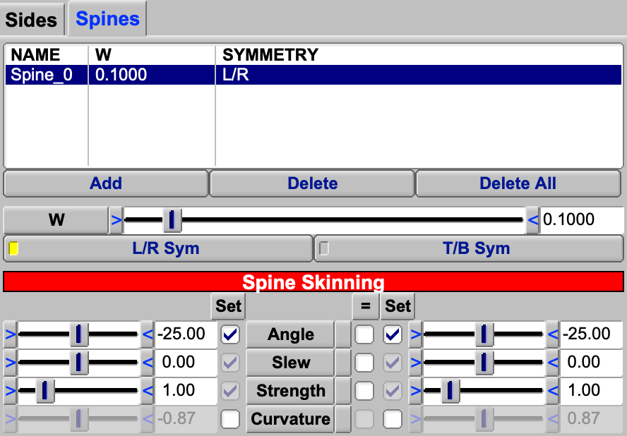

*图 9. Stack 截面 1 的 Spines，选中 W 0.1 的脊线，左右镜像，并在前后两侧约束 Angle -25。*

脊线属于整个组件：在各截面上具有相同 W、对称设置和名称；添加或删除会作用于全部截面。其蒙皮数值则像四侧一样，在每个截面分别设置。

脊线只控制两侧相邻站位之间的曲面（图 10），因此少量脊线即可局部塑形，例如棱线、整流体或平面面板。

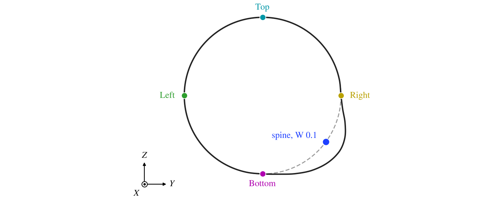

*图 10. 在 Stack 前两个截面中间切开。虚线为中截面四侧均约束 Angle 0；实线还增加 W 0.1、Angle -25 的脊线。只有 Right 与 Bottom 之间的四分之一区域改变。*

## 以截面曲线确定角度基准

角度需要一个使曲面倾斜的参考方向。默认取圆的方向：截面参数 $t$ 处，对应圆在该处的外向方向。对于左右、上下均对称的任意截面，四侧方向准确；但离开四侧后，非圆截面实际朝向通常不同。*Angle Basis From Curve* 改为使用截面曲线的方向，即在截面平面内垂直于该站位曲线的方向（图 11）。

在非圆截面的脊线上设置角度时应开启此项，否则角度还会引入周向偏斜。在对称截面的四侧，两种基准一致。

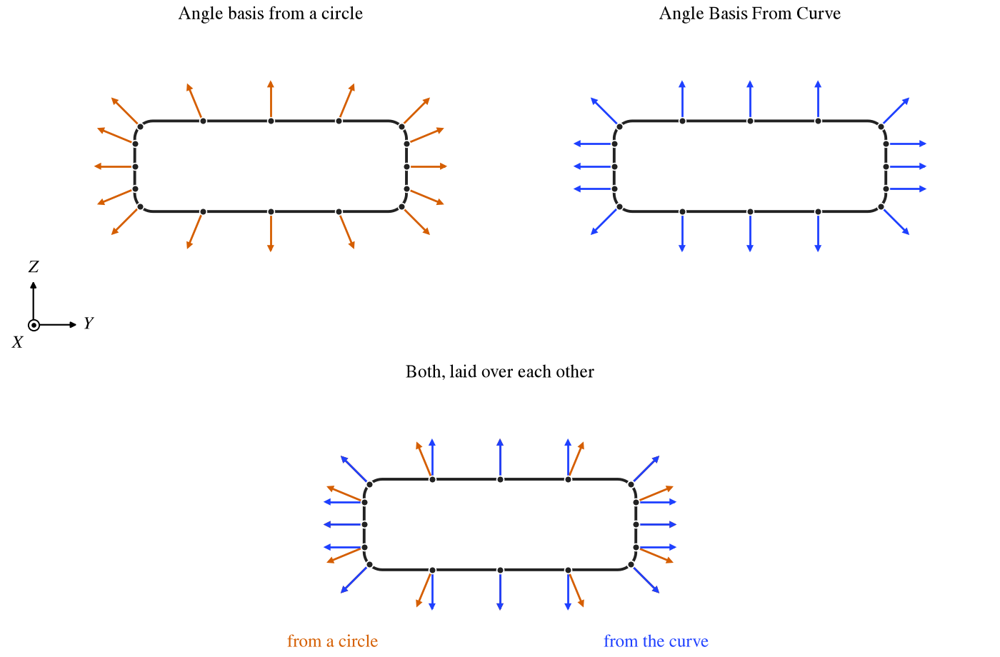

*图 11. 宽为高三倍的圆角矩形，四侧及十二条脊线均约束 Angle 30。箭头表示曲面方向的横向分量：圆基准（橙色）如圆的径向般散开，曲线基准（蓝色）垂直各平边。下方叠加显示两者，仅四侧一致。*

## 显示与清除蒙皮条件

*Show Tangent Vectors* 在当前截面各站位绘制两侧曲面的一阶导数，按完整长度和站位颜色显示：朝下一截面离开处为实线，从上一截面到达处为虚线。*Show Curvature Vectors* 同样显示二阶导数。既显示施加的条件，也显示未约束处曲面的实际行为。

*Clear Skinning For XSec* 关闭当前截面（含脊线）的全部 Set 和 =，使曲面在此自由，并开启 All Sym；*Clear Skinning For Entire Stack* 对全部截面执行同样操作。

## 建议

- 不需要指定形状的截面可保持自由，只约束重要部分。自由截面显示实际结果，通常是进一步设置的良好起点。
- 从少量条件开始，逐个增加并每次观察曲面。每个条件会提高所作用段的多项式次数；条件多并不一定更好，反而更难预测。
- 没有其他约束时，C1/C2 可使体部光滑，C0 则在截面之间直线连接。形状重要处应设置角度，不要仅依赖连续性。
- 优先用四侧及对称开关塑形；只有四侧无法控制的局部才加脊线，非圆截面添加脊线时开启 Angle Basis From Curve。
- 用 Strength 塑造头尾，用 C0 下独立的 Left/Right 角度形成有意设置的折痕。

## 脚本

API 按方位设置截面蒙皮，并按 ID 操作脊线：

| 调用 | 用途 |
|:-----|:-----|
| `InsertXSec`, `CutXSec`, `CopyXSec`, `PasteXSec` | 插入、剪切、复制和粘贴截面。 |
| `SetXSecContinuity`, `GetXSecContinuity` | 设置或读取截面连续性，0 至 2。 |
| `SetXSecTanAngles`, `SetXSecTanSlews`, `SetXSecTanStrengths`, `SetXSecCurvatures` | 设置截面前后某一侧的 Top、Right、Bottom、Left 值。 |
| `GetXSecTanAngles`, `GetXSecTanSlews`, `GetXSecTanStrengths`, `GetXSecCurvatures` | 读取这些值。 |
| `ClearSkinning` | 清除一个或全部截面的蒙皮条件，与 Clear Skinning 按钮相同。 |
| `ResetXSecSkinParms` | 清除截面蒙皮，并将全部角度、Slew、Strength、Curvature 设为 0，同时开启 All、T/B、R/L Sym。 |
| `AddSkinSpine`, `DelSkinSpine`, `DelAllSkinSpines`, `GetNumSkinSpines` | 添加、删除脊线或查询数量。 |
| `GetSkinSpineID`, `GetSkinSpineIDVec`, `GetSkinSpineParm`, `SetSkinSpineName` | 访问截面上的脊线及其参数，并设置名称。 |

Set、= 和对称开关是截面参数，可用 `GetXSecParm` 查找，例如 `TopLAngleSet`、`TopLRAngleEq`、`AllSym` 等。
